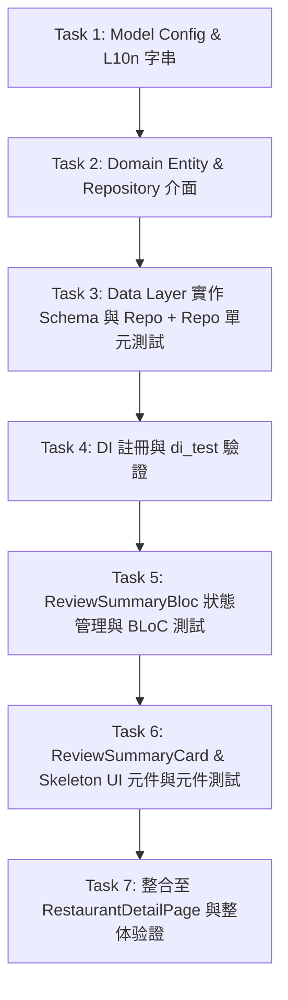

# Implementation Plan: 餐廳評論智慧摘要 (Review Intelligence & Highlights)

> 項目編號：**M5-Review**  
> 建立日期：2026-10-19  
> 關聯規格：`docs/features/2026-10-19-review-summary.md`  
> 預估任務總數：7  

---

## 1. 架構設計與核心決策 (Architecture & Design Decisions)

### 1.1 遵循原則 (Linus x Ponytail)
1. **Never break userspace（零破壞）**：
   - AI 評論情報為非同步、非阻塞式的增強卡片，完全不干擾 `RestaurantDetailPage` 與 `RestaurantDetailBloc` 的原有生命週期與錯誤處理。
   - 若短評為 0 則，BLoC 直接切入 `ReviewSummaryEmpty` 狀態，卡片輸出 `SizedBox.shrink()`，零 API 浪費、零額外留白。
   - 若 AI API 失敗（429 配額不足、逾時、網路斷線），僅在該卡片內展示可重試的輕量提示，整頁詳情（資訊、營業時間、照片、原生評論、最愛）100% 正常運作。
2. **消滅特殊情況（好品味）**：
   - Prompt 系統指令統一指定輸出繁體中文，消除客戶端多語言翻譯的分支邏輯。
   - 利用 `firebase_ai` 的 `GenerationConfig.responseSchema` 實施強型別輸出，保證回傳 JSON 格式與欄位型別 100% 吻合。
3. **拒絕無效抽象（YAGNI）**：
   - BLoC 直接依賴 `ReviewSummaryRepository`，不建立單純轉發的 `UseCase` 類別。
   - 自帶依賴注入與生命週期管理，UI 傳入 `detail` 與 `reviews` 即可運作，便於 Widget Test 替換 Mock。

---

## 2. 檔案異動清單 (File Changes Matrix)

| 類型 | 檔案路徑 | 說明 |
|---|---|---|
| **Config** | `lib/api/dto/ai_model_config.dart` | 新增 `review_summary_model`、`review_summary_temperature`、`review_summary_system_instruction` 等 Remote Config 讀取與預設常數 |
| **L10n** | `lib/l10n/intl_en.arb`<br>`lib/l10n/intl_zh_TW.arb` | 新增情報卡各區塊標題、按鈕文字、錯誤狀態之多國語系字串 |
| **Domain** | `lib/domain/entities/review_summary_entity.dart`<br>`lib/domain/entities/entities_barrel.dart` | 定義 `ReviewSummaryEntity`（支援 `@JsonSerializable` 與 `Equatable`）並加入 barrel 導出 |
| **Domain** | `lib/domain/repositories/review_summary_repository.dart`<br>`lib/domain/repositories/repositories_barrel.dart` | 定義 `ReviewSummaryRepository` 介面契約並加入 barrel 導出 |
| **Data** | `lib/data_layer/repositories/review_summary_schema.dart` | 定義 Gemini 結構化輸出綱要 `reviewSummarySchema` |
| **Data** | `lib/data_layer/repositories/review_summary_repo.dart`<br>`lib/data_layer/repositories/repositories_barrel.dart` | 實作 `ReviewSummaryRepo`（支援 `FirebaseAI`、Prompt 組合、`promptExecutor` 打樁測試） |
| **DI** | `lib/app/di/injection.dart` | 於 GetIt 註冊 `ReviewSummaryRepository -> ReviewSummaryRepo` |
| **BLoC** | `lib/flow/restaurant/bloc/review_summary_event.dart`<br>`lib/flow/restaurant/bloc/review_summary_state.dart`<br>`lib/flow/restaurant/bloc/review_summary_bloc.dart`<br>`lib/flow/restaurant/bloc/bloc_barrel.dart` | 實作獨立的 `ReviewSummaryBloc` 狀態管理與 barrel 導出 |
| **UI** | `lib/features/component/cell/restaurant_detail/review_summary_skeleton.dart` | 實作 Material 3 骨架屏（Shimmer）載入預覽 |
| **UI** | `lib/features/component/cell/restaurant_detail/review_summary_card.dart`<br>`lib/features/component/cell/restaurant_detail/cell_barrel.dart` | 實作情報卡主元件（Pros 值得一試、Cons 注意事項、Highlights 招牌必點、Summary 一句話總評、重試機制） |
| **View** | `lib/flow/restaurant/view/restaurant_detail_page.dart` | 於 `RestaurantCommentCell` 之上掛載 `ReviewSummaryCard` |
| **Test** | `test/data_layer/review_summary_repo_test.dart` | 測試 Schema 結構、成功解析、空評論防禦與異常降級處理 |
| **Test** | `test/flow/restaurant/review_summary_bloc_test.dart` | 使用 `blocTest` 驗證 Initial -> Loading -> Success / Failure / Empty 狀態流轉與重試 |
| **Test** | `test/component/restaurant_detail/review_summary_card_test.dart` | 測試卡片在 Loading (Skeleton)、Success (內容與 Chips)、Failure (Retry 按鈕) 與 Empty (SizedBox.shrink) 下的渲染 |
| **Test** | `test/di_test.dart` | 補充 `ReviewSummaryRepository` 在 GetIt 中的解析單元測試 |

---

## 3. 實作任務細部規劃 (Task Breakdown & Sequence)



### Task 1: 擴充 AiModelConfig 與 L10n 多國語系字串
- **目標**：配置 Remote Config 參數以及 UI 提示文字。
- **檔案**：
  - `lib/api/dto/ai_model_config.dart`
  - `lib/l10n/intl_en.arb`
  - `lib/l10n/intl_zh_TW.arb`
- **具體改動**：
  - 增加常數：
    - `defaultReviewSummaryModel = 'gemini-3.5-flash-lite'`
    - `defaultReviewSummaryTemperature = 0.2`
    - `defaultReviewSummarySystemInstruction = '''你是一位米其林美食評審與大數據食評分析專家。請閱讀給予的餐廳資訊與顧客評論，客觀提煉出：1. 值得一試 (pros: 1~3 項) 2. 注意事項或避雷點 (cons: 1~2 項) 3. 招牌必點或特色菜品 (highlights: 1~3 項) 4. 一句話短評總結 (summary: ≤ 40 字)。無論原始評論語言為何，一律以繁體中文 (zh-TW) 輸出。嚴格符合 JSON Schema。'''`
  - 增加 getter: `reviewSummaryModel`, `reviewSummaryTemperature`, `reviewSummarySystemInstruction`
  - 在 `intl_en.arb` 與 `intl_zh_TW.arb` 增加對應多國語系 key，並執行 `dart run intl_utils:generate`。

### Task 2: 定義 Domain Entity 與 Repository 介面契約
- **目標**：建立強型別領域模型與倉儲契約。
- **檔案**：
  - `lib/domain/entities/review_summary_entity.dart`
  - `lib/domain/entities/entities_barrel.dart`
  - `lib/domain/repositories/review_summary_repository.dart`
  - `lib/domain/repositories/repositories_barrel.dart`
- **具體改動**：
  - `ReviewSummaryEntity`:
    ```dart
    @immutable
    @JsonSerializable(
      checked: true,
      fieldRename: FieldRename.snake,
      includeIfNull: false,
    )
    class ReviewSummaryEntity extends Equatable {
      const ReviewSummaryEntity({
        this.pros = const [],
        this.cons = const [],
        this.highlights = const [],
        this.summary = '',
      });

      factory ReviewSummaryEntity.fromJson(Map<String, Object?> json) =>
          _$ReviewSummaryEntityFromJson(json);

      @JsonKey(fromJson: stringListFromJson, defaultValue: [])
      final List<String> pros;

      @JsonKey(fromJson: stringListFromJson, defaultValue: [])
      final List<String> cons;

      @JsonKey(fromJson: stringListFromJson, defaultValue: [])
      final List<String> highlights;

      @JsonKey(defaultValue: '')
      final String summary;

      Map<String, Object?> toJson() => _$ReviewSummaryEntityToJson(this);

      @override
      List<Object?> get props => [pros, cons, highlights, summary];
    }
    ```
  - `ReviewSummaryRepository`:
    ```dart
    abstract interface class ReviewSummaryRepository {
      Future<ReviewSummaryEntity> generateReviewSummary({
        required RestaurantDetailEntity detail,
        required List<ReviewDetailEntity> reviews,
      });
    }
    ```
  - 執行 `dart run build_runner build --delete-conflicting-outputs` 產生 `.g.dart`。

### Task 3: 實作 Data Layer (Schema, Repo) 與單元測試
- **目標**：透過 `firebase_ai` 實作強型別結構化輸出與優雅容錯。
- **檔案**：
  - `lib/data_layer/repositories/review_summary_schema.dart`
  - `lib/data_layer/repositories/review_summary_repo.dart`
  - `lib/data_layer/repositories/repositories_barrel.dart`
  - `test/data_layer/review_summary_repo_test.dart`
- **具體改動**：
  - 定義 `reviewSummarySchema` 物件規範（pros, cons, highlights 為 string 陣列，summary 為 string）。
  - `ReviewSummaryRepo`：
    - 接收 `FirebaseAI?`, `ReviewSummaryPromptFunction? promptExecutor`, `AiModelConfig?`。
    - 實作 `generateReviewSummary`：
      - 遇 `reviews.isEmpty` 時拋出例外或短路。
      - 若有 `promptExecutor` 則直接呼叫並反序列化（測試專用）。
      - 呼叫 `GenerativeModel.generateContent`，解析 `response.text` 為 `ReviewSummaryEntity`。
  - 編寫單元測試覆蓋：
    1. Schema 欄位完整性驗證。
    2. 合法 JSON 格式正確解析至 Entity。
    3. 空字串/格式毀損/例外情況之正確捕捉。

### Task 4: 依賴注入 (DI) 配置與驗證
- **目標**：在 GetIt 容器註冊 `ReviewSummaryRepository`。
- **檔案**：
  - `lib/app/di/injection.dart`
  - `test/di_test.dart`
- **具體改動**：
  - `lib/app/di/injection.dart`:
    ```dart
    getIt.registerLazySingleton<ReviewSummaryRepository>(() => ReviewSummaryRepo());
    ```
  - `test/di_test.dart` 增加驗證項目：
    ```dart
    test('ReviewSummaryRepository resolves to ReviewSummaryRepository', () {
      expect(GetIt.I.isRegistered<ReviewSummaryRepository>(), isTrue);
      final repo = GetIt.I<ReviewSummaryRepository>();
      expect(repo, isA<ReviewSummaryRepository>());
    });
    ```

### Task 5: 實作 ReviewSummaryBloc 與 BLoC 單元測試
- **目標**：管理評論情報的獨立狀態生命週期。
- **檔案**：
  - `lib/flow/restaurant/bloc/review_summary_event.dart`
  - `lib/flow/restaurant/bloc/review_summary_state.dart`
  - `lib/flow/restaurant/bloc/review_summary_bloc.dart`
  - `lib/flow/restaurant/bloc/bloc_barrel.dart`
  - `test/flow/restaurant/review_summary_bloc_test.dart`
- **具體改動**：
  - Event:
    - `FetchReviewSummary({required RestaurantDetailEntity detail, required List<ReviewDetailEntity> reviews})`
    - `RetryReviewSummary()`
  - State:
    - `ReviewSummaryInitial()`
    - `ReviewSummaryLoading()`
    - `ReviewSummarySuccess({required ReviewSummaryEntity summary})`
    - `ReviewSummaryFailure({required String errorMessage, required bool canRetry})`
    - `ReviewSummaryEmpty()`
  - BLoC 內部快取 `_lastDetail` 與 `_lastReviews`，支援無縫 Retry。
  - 單元測試（使用 `blocTest` 與 `mocktail`）：
    1. 空評論列表觸發 `FetchReviewSummary` -> 立即發射 `ReviewSummaryEmpty`。
    2. 有評論成功生成 -> 發射 `[ReviewSummaryLoading, ReviewSummarySuccess]`。
    3. Repo 拋出異常 -> 發射 `[ReviewSummaryLoading, ReviewSummaryFailure]`。
    4. 失敗後調用 `RetryReviewSummary` -> 發射 `[ReviewSummaryLoading, ReviewSummarySuccess]`。

### Task 6: 打造 ReviewSummaryCard & Skeleton UI 元件與測試
- **目標**：設計符合 Material 3 風格之評論情報卡片。
- **檔案**：
  - `lib/features/component/cell/restaurant_detail/review_summary_skeleton.dart`
  - `lib/features/component/cell/restaurant_detail/review_summary_card.dart`
  - `lib/features/component/cell/restaurant_detail/cell_barrel.dart`
  - `test/component/restaurant_detail/review_summary_card_test.dart`
- **具體改動**：
  - `ReviewSummarySkeleton`:
    - 結合 `Skeleton` 與 `ThemeSize`，尺寸高度自適配，避免版面跳動。
  - `ReviewSummaryCard`:
    - 支援傳入 `ReviewSummaryBloc? bloc`（預設從 `GetIt.I<ReviewSummaryRepository>()` 建立，若外部未傳入則本機管理生命週期）。
    - 根據 State 呈現：
      - `ReviewSummaryEmpty` / `ReviewSummaryInitial`: `SizedBox.shrink()`
      - `ReviewSummaryLoading`: `ReviewSummarySkeleton()`
      - `ReviewSummaryFailure`: 友善提示與 Retry 按鈕
      - `ReviewSummarySuccess`:
        - 頂部：✨ AI 評論情報晶片與 `summary` 一句話總評
        - 中間：🟢 值得一試 (Pros) 條列與 🔴 注意事項 (Cons) 條列
        - 底部：⭐ 招牌必點 Action/Suggestion Chips
  - 元件測試（Widget Test）：
    - 驗證 Loading 時出現 Skeleton。
    - 驗證 Success 時正確渲染 Pros、Cons、Highlights 與 Summary。
    - 驗證 Failure 時渲染重試按鈕並能觸發 Event。
    - 驗證 Empty 時不佔用任何空間。

### Task 7: 整合至 RestaurantDetailPage 與整體驗證
- **目標**：掛載至詳情頁，端到端驗收。
- **檔案**：
  - `lib/flow/restaurant/view/restaurant_detail_page.dart`
- **具體改動**：
  - 於 `ListView` 的 `RestaurantCommentCell` 之上掛載：
    ```dart
    ReviewSummaryCard(
      detail: state.detailInfo,
      reviews: state.reviewInfo.reviews ?? [],
    ),
    ```
  - 運行全域靜態分析與測試集：
    - `dart format --set-exit-if-changed .`
    - `flutter analyze .`
    - `flutter test`

---

## 4. 驗證與驗收標準 (Verification Checklist)

- [ ] **靜態檢查**：`flutter analyze .` 零警告、零錯誤。
- [ ] **自動化測試**：
  - `test/data_layer/review_summary_repo_test.dart` 通過
  - `test/flow/restaurant/review_summary_bloc_test.dart` 通過
  - `test/component/restaurant_detail/review_summary_card_test.dart` 通過
  - `test/di_test.dart` 通過
  - 全套 `flutter test` 綠燈通過。
- [ ] **向後相容性**：既有 `RestaurantCommentCell` 與短評導外 Yelp 行為完全不受影響；AI 故障不影響詳情頁渲染。
