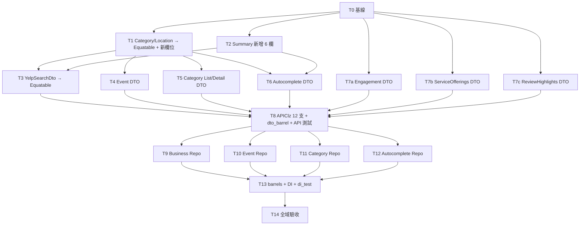

# Implementation Plan：補齊 Yelp Places API 12 支端點（API 層＋Repository 層）

> 項目編號：**A-8.9／A-8.12（僅 API＋Repository 部分）**
> 建立日期：2026-10-23
> 關聯規格：[`docs/features/2026-10-23-yelp-places-api-coverage.md`](../features/2026-10-23-yelp-places-api-coverage.md)（下稱「規格」，§ 編號沿用規格）
> 實查基線：`main` @ `ecd648d`
> 狀態：草稿（STAGE 0b，第 1 次修正，回應 plan-verifier 初審；§11 有 1 項待使用者決策）

---

## 1. 簡介與目標

在 `APIClz` 新增 12 支 Retrofit 方法，為每種回應準備 DTO，再接上 4 組 Repository（介面在 `lib/domain/repositories/`，實作在 `lib/data_layer/repositories/`）並完成 DI 註冊。不做 BLoC、UI、Entity。

使用者在 0b 的裁決（必須遵守）：

- **共用結構一律擴充既有 DTO，不另建重複類別**：
  - #1、#2、#3 的回應重用並修改 `YelpSearchDto`。
  - Business、Category、Location 擴充既有的 `YelpRestaurantSummaryDto`、`YelpRestaurantCategoryDto`、`YelpRestaurantLocationDto`。
  - 只有既有程式沒有對應結構的回應才新建 DTO。
- **Q4 邊界放寬**：允許修改既有 DTO，以容納新欄位，或改成 `final`／`Equatable`。但既有端點的方法簽章不變，A-8.7、A-8.8、A-8.10 的範圍仍然不碰。
- **Never break userspace**：既有呼叫端**觀察不到任何語意變化**。Category／Location 的 `==` 確實會從 identity 相等改為值相等，但沒有任何呼叫端觀察這兩個 DTO 的相等性（見 §4.1）。可變欄位的寫入點、Firestore 持久化格式、既有測試的語意也都不變。

---

## 2. 架構設計與 Trade-off

### 2.1 實作方向比較（工作怎麼切）

| 方向 | 作法 | 優點 | 缺點 |
|---|---|---|---|
| **A. 依層水平切，序列執行（採用）** | 共用 DTO → 新 DTO（依資源分組）→ `APIClz`（單一任務）→ Repository（依資源分組）→ barrel 與 DI（單一任務） | 共用檔（`api_clz.dart`、`dto_barrel.dart`、兩個 `repositories_barrel.dart`、`injection.dart`、`di_test.dart`）**每個只由一個任務寫入**，每個 commit 只處理一件事、易於 review。每個任務結束時都能編譯、零警告、全綠 | 任務數較多（15 個）。新 DTO 要到 T8 才會從 barrel 匯出，在那之前測試以檔案路徑直接 import（規則見 §6.0） |
| B. 依資源垂直切（Business／Event／Category／Autocomplete 各做一整條） | 每條各自完成 DTO、`APIClz`、Repository、DI | 每條都是可展示的完整功能 | 每個共用檔要改 4 次，`api_clz.g.dart` 也要重新產生 4 次。單一 commit 混合 4 層，review 和回退的單位都比較粗 |
| C. 一次到位 | 單一任務完成全部 | 單人執行時最省心 | diff 太大，違反規格 R-8；中途壞掉時沒有檢查點可以回退 |

**選 A。** 判準是「每個共用檔只有一個寫入者」。這個條件成立後，每個 commit 都是單一關注點，相依順序也是顯式的。

### 2.2 規格待決事項的落地

| 編號 | 決定 | 實查依據與補充 |
|---|---|---|
| D-1 | 拆成 4 組 Repository：`YelpBusinessRepository`（#1–#6）、`YelpEventRepository`（#7–#9）、`YelpCategoryRepository`（#10–#11）、`YelpAutocompleteRepository`（#12）。實作各自命名為 `Yelp*Repo` | 加上 `Yelp` 前綴，避免 `CategoryRepository` 之類的通用名稱和其他「分類」概念混淆 |
| D-2 | E1：**不 catch、不記 log**，`DioException` 原樣往上拋。#4–#6 在介面用 `///` 標明 403 | `DioClient` 已經掛上 `LogInterceptor`（`dio_client.dart`，`error` 預設為 true），在 Repository 再記一次會重複。做法和 `RestaurantDetailRepo` 一致，12 支端點的錯誤路徑相同 |
| D-3 | Repository **直接回傳 `APIClz` 的結果**，連外殼 DTO 也不拆（#11 回傳 `YelpCategoryDetailDto`，不拆成 `.category`） | 拆殼後，`category == null` 會變成一個需要特別處理的情況。直接透傳，12 支的處理方式完全相同 |
| D-4 | (a)，並依使用者裁決延伸到 Business、Category、Location | 詳見 §4 |
| D-5 | `APIClz` 的陣列參數宣告成 `String?`，由 Repository 對外接收 `List<…>`，再以 `join(',')` 組成字串 | 分隔符號定義成各 Repo 內的 `static const String _listSeparator = ','`（flutter-styles §Y.1） |
| D-6 | **新建的** DTO 加上 `checked: true`。被修改的既有 DTO **不加** | 既有 DTO 加上 `checked` 會讓 `businessesSearch`／`business` 的解析失敗從 `TypeError` 變成 `CheckedFromJsonException`，等於改了既有端點的錯誤行為，違反 Q4。新的外殼 DTO 內嵌既有 DTO 時，`$checkedConvert` 會用 `catch (error, stack)` 把內層的 `TypeError` 一併包成 `CheckedFromJsonException`（`json_annotation-4.12.0/lib/src/checked_helpers.dart` 的 `$checkedNew`） |

### 2.3 已核對的關鍵事實

- **lint**：`flutter_lints 5.0.0` 啟用了 `prefer_const_constructors_in_immutables`，而 `Equatable` 帶有 `@immutable`（`equatable-2.1.0/lib/src/equatable.dart:25`），所以改成 `Equatable` 的 DTO **必須**有 `const` 建構式。另外，`analysis_options.yaml` 啟用了 `prefer_const_constructors` 與 `prefer_const_declarations`，因此既有呼叫點若傳入的都是常數，就會被要求改成 `const`（見 §4.1、§11 D-7）。
- **`APIClz` 可以直接用 mocktail 替身**：`class _MockAPIClz extends Mock implements APIClz {}`。`APIClz` 是 abstract class，factory 建構式不影響 `implements`。
- **API 層測試不需要假的 adapter**：在 `Dio()` 加一個 `InterceptorsWrapper`，在 `onRequest` 內記下 `RequestOptions`，再以 `handler.resolve(Response(data: <String, dynamic>{}))` 直接回應即可。因為所有 DTO 欄位都是 nullable，`fromJson({})` 都能成功。專案在 `api_clz.dart:57` 已經這樣用過 `InterceptorsWrapper`，不必引入新概念。
- **retrofit 產生碼**會以 `queryParameters.removeWhere((k, v) => v == null)`（`api_clz.g.dart:90`）丟掉 null，但空字串會保留，所以 #2 傳入 `address1: ''` 時仍然會送出這個參數（AC-6）。
- **版本**：retrofit 4.10.0、retrofit_generator 10.2.11、json_serializable 6.14.1、json_annotation 4.12.0、equatable 2.1.0、dio 5.11.1、mocktail 1.0.5（`pubspec.lock`）。不新增任何相依（AC-14）。`json_annotation` 是 direct dependency（`pubspec.yaml:84`），測試可以直接 import 它來取得 `CheckedFromJsonException`。
- **git 路徑**：git root 是 `Finding-Restaurant-Flutter/`，在本專案的上兩層，所以 `git status --porcelain` 輸出的路徑都帶有 `flutter_restaruant/flutter_restaruant/` 前綴（實測過；加上 `-- .` 也一樣）。本計畫的檔案清單比對一律改用 `git diff --name-only --relative`，搭配 `git ls-files --others --exclude-standard`；後者輸出的就是相對於當前目錄的路徑。
- **產生碼都有進版控**：`*.g.dart` 共 18 個、`lib/generated/intl/*` 都已在版控中，所以新 worktree 不需要額外跑產生器就能編譯。

---

## 3. 資料結構

### 3.1 端點 → DTO → Repository 對照

| # | `APIClz` 方法 | 回應 DTO | Repository 方法 |
|---|---|---|---|
| 1 | `businessesSearchByPhone` | `YelpSearchDto`（既有，修改） | `YelpBusinessRepository.searchByPhone` |
| 2 | `businessesMatches` | `YelpSearchDto`（`total` 恆為 null） | `YelpBusinessRepository.matchBusinesses` |
| 3 | `transactionsSearch` | `YelpSearchDto` | `YelpBusinessRepository.searchDelivery` |
| 4 | `businessesEngagement` | `YelpEngagementDto`（新） | `YelpBusinessRepository.fetchEngagement` |
| 5 | `businessServiceOfferings` | `YelpServiceOfferingsDto`（新） | `YelpBusinessRepository.fetchServiceOfferings` |
| 6 | `businessReviewHighlights` | `YelpReviewHighlightsDto`（新） | `YelpBusinessRepository.fetchReviewHighlights` |
| 7 | `eventsSearch` | `YelpEventSearchDto`（新） | `YelpEventRepository.searchEvents` |
| 8 | `event` | `YelpEventDto`（新） | `YelpEventRepository.fetchEvent` |
| 9 | `featuredEvent` | `YelpEventDto` | `YelpEventRepository.fetchFeaturedEvent` |
| 10 | `categories` | `YelpCategoryListDto`（新） | `YelpCategoryRepository.fetchCategories` |
| 11 | `category` | `YelpCategoryDetailDto`（新） | `YelpCategoryRepository.fetchCategory` |
| 12 | `autocomplete` | `YelpAutocompleteDto`（新） | `YelpAutocompleteRepository.autocomplete` |

### 3.2 DTO 欄位與共用關係

共通約定：

- JSON key 一律使用 snake_case（`fieldRename: FieldRename.snake`）。
- 所有欄位都是 nullable，不使用 `defaultValue`。
- `fromJson` 的參數型別是 `Map<String, dynamic>`。這是為了和 `lib/api/dto/` 的既有 DTO 一致，也對應 retrofit 產生碼的 `_dio.fetch<Map<String, dynamic>>`。
- 一個檔案只放一個類別，沿用 `lib/api/dto/` 的現行慣例。

**既有 DTO（修改）**

| DTO | 欄位（新增的以 **粗體** 標示） | Equatable | 被誰使用 |
|---|---|---|---|
| `YelpSearchDto` | `businesses: List<YelpRestaurantSummaryDto>?`、`total: int?` | **改為是**（加上 `explicitToJson`） | `businessesSearch`（既有）、#1、#2、#3 |
| `YelpRestaurantSummaryDto` | 既有 11 欄 + `favor`；新增 **`alias: String?`**、**`isClosed: bool?`**、**`url: String?`**、**`transactions: List<String>?`**、**`displayPhone: String?`**、**`attributes: Map<String, Object?>?`** | **否**（保留只比 `id` 的 `==`，欄位維持可變，原因見 §4.3） | `YelpSearchDto.businesses`（既有、#1–#3）、`YelpAutocompleteDto.businesses`（#12，只會有 `id`、`name`）、`FavorDataSource`（Firestore）、`RestaurantEntity` |
| `YelpRestaurantCategoryDto` | `alias`、`title`；新增 **`parentAliases`**、**`countryWhitelist`**、**`countryBlacklist`**（三者皆為 `List<String>?`） | **改為是**，並改成 `const` 建構式 | `Summary.categories`、`Detail.categories`、#10、#11、#12、`RestaurantCategoryEntity` |
| `YelpRestaurantLocationDto` | 既有 7 欄；新增 **`zipCode: String?`**、**`crossStreets: String?`** | **改為是**，並改成 `const` 建構式 | `Summary.location`（#1–#3）、`Detail.location`、`YelpEventDto.location`（#7–#9）、`RestaurantLocationEntity` |
| `YelpRestaurantCoordinatesDto` | **不動** | 否 | 沒有任何新的 Equatable DTO 內嵌它（Event 的經緯度是平鋪欄位），所以不需要修改 |

**新建 DTO**：全部 `@JsonSerializable(checked: true, fieldRename: FieldRename.snake)`，有巢狀物件的再加上 `explicitToJson: true`。全部 `extends Equatable`，使用 `const` 建構式，欄位皆為 `final`。

| DTO | 檔案 | 欄位 | 被誰使用 |
|---|---|---|---|
| `YelpEventDto` | `yelp_event_dto.dart` | `id`、`name`、`description`、`businessId`、`category`、`eventSiteUrl`、`imageUrl`、`ticketsUrl`、`timeStart`、`timeEnd`：`String?`；`cost`、`costMax`、`latitude`、`longitude`：`double?`；`attendingCount`、`interestedCount`：`int?`；`isCanceled`、`isFree`、`isOfficial`：`bool?`；`location: YelpRestaurantLocationDto?`（共 20 欄，`explicitToJson`） | #7 的元素、#8、#9 |
| `YelpEventSearchDto` | `yelp_event_search_dto.dart` | `events: List<YelpEventDto>?`、`total: int?`（`explicitToJson`） | #7 |
| `YelpCategoryListDto` | `yelp_category_list_dto.dart` | `categories: List<YelpRestaurantCategoryDto>?`（`explicitToJson`） | #10 |
| `YelpCategoryDetailDto` | `yelp_category_detail_dto.dart` | `category: YelpRestaurantCategoryDto?`（`explicitToJson`） | #11 |
| `YelpAutocompleteDto` | `yelp_autocomplete_dto.dart` | `categories: List<YelpRestaurantCategoryDto>?`、`businesses: List<YelpRestaurantSummaryDto>?`、`terms: List<YelpAutocompleteTermDto>?`（`explicitToJson`）。類別上的 `///` 和 `YelpSearchDto` 相同，註明 `businesses` 的元素只比 id | #12 |
| `YelpAutocompleteTermDto` | `yelp_autocomplete_term_dto.dart` | `text: String?` | #12 |
| `YelpEngagementDto` | `yelp_engagement_dto.dart` | `data: List<YelpBusinessEngagementDto>?`（`explicitToJson`） | #4 |
| `YelpBusinessEngagementDto` | `yelp_business_engagement_dto.dart` | `businessId: String?`、`metrics: List<YelpEngagementMetricDto>?`（`explicitToJson`） | #4 |
| `YelpEngagementMetricDto` | `yelp_engagement_metric_dto.dart` | `startOfWeekDate: String?`、`engagementMetric`、`intentMetric`、`transactionMetric`：`int?` | #4 |
| `YelpServiceOfferingsDto` | `yelp_service_offerings_dto.dart` | `active`、`eligible`：`List<String>?` | #5 |
| `YelpReviewHighlightsDto` | `yelp_review_highlights_dto.dart` | `reviewHighlights: List<YelpReviewHighlightDto>?`（`explicitToJson`） | #6 |
| `YelpReviewHighlightDto` | `yelp_review_highlight_dto.dart` | `photo`、`sentence`：`String?`；`reviewCount: int?`。`sentence` 中的 `[[HIGHLIGHT]]` 標記保持原字串，不解析 | #6 |

類別總數：新建 12 個，修改 4 個。規格 §3.2 的 4 種主資源（Business、Event、Category、Autocomplete 建議）各只有一種型別，沒有平行定義的重複類別。

---

## 4. 既有 DTO 的修改與受影響呼叫端

使用點依據：在 `lib/`、`test/`、`integration_test/` 下 grep 類別名稱，排除 `*.g.dart`；欄位寫入點以 `\.(alias|title|address[123]|city|country|state|displayAddress|businesses|total|favor|latitude|longitude) = ` 搜尋。

### 4.1 `YelpRestaurantCategoryDto` 與 `YelpRestaurantLocationDto`（T1）

**改動**：

- 欄位全部改為 `final`，類別改成 `extends Equatable`，建構式改成 `const`。
- 新增欄位都加上 `@JsonKey(includeIfNull: false)`。
- Category 補上 `fieldRename: FieldRename.snake`。`alias`、`title` 本來就是單字，所以 JSON key 不變。

| 呼叫端 | 用法 | 受影響？ | 處理 |
|---|---|---|---|
| `restaurant_category_entity.dart:9-10,12-13`、`restaurant_location_entity.dart:22-41` | `fromDto` 讀欄位；`toDto` 以實例欄位呼叫建構式（引數不是常數） | 否 | 不改 |
| `yelp_restaurant_summary_dto.dart:21-22`、`yelp_restaurant_detail_dto.dart:17-18` | 作為欄位型別。Summary 的 `==` 只比 `id`，Detail 沒有覆寫 `==` | 否：這兩個父類別的相等性都不會比到內層的 Category／Location | 不改 |
| `main_repo.dart:52`（`/v3/businesses/search` → `YelpSearchDto` → Summary 的 `categories`／`location`） | 正式環境的解析路徑 | **解析範圍擴大**：`zip_code`、`cross_streets` 這次會被解析（`parent_aliases` 等欄位 search 不會給，讀出來是 null）。Yelp 若回傳型別不符，主列表就會解析失敗 | 型別依官方 schema（`string`）定義。併入 §8 R-B 的上線前人工抽查 |
| `restaurant_detail_repo.dart:21`（`/v3/businesses/{id}` → `YelpRestaurantDetailDto` 的 `categories`／`location`） | 正式環境的解析路徑 | 同上：詳情頁會開始解析新欄位 | 同上，R-B 的抽查涵蓋 detail 端點 |
| `favor_data_source.dart:89`（Firestore 讀取 → `YelpRestaurantSummaryDto.fromJson` → 巢狀的 Category／Location） | 讀取既有的最愛 document | 否：舊 document 沒有新 key，讀出來是 null；本版寫入的 document 也不會有這些 key（下一列） | 不改 |
| `favor_data_source.dart:122` → `toDto.toJson()` 寫入 Firestore | 透過 Summary 的 `explicitToJson` 遞迴序列化 | **可能**：新欄位若輸出 `null` key，Firestore document 的形狀會改變 | 新欄位加上 `includeIfNull: false`。`RestaurantEntity` 不攜帶新欄位，所以它們永遠是 null、永遠不會輸出，**payload 和現在逐鍵相同**。由 T1、T2 的鍵集合測試鎖住 |
| `test/empirical_m3_stress_test.dart:25,35,74,78` | `final x = YelpRestaurant{Category,Location}Dto(...)`，引數全部是常數 | **lint**：建構式改成 `const` 之後會觸發 `prefer_const_constructors`，改成 `final x = const …` 又會觸發 `prefer_const_declarations` | 這 4 行從 `final` 改成 `const`，其餘一字不動。不改任何 `expect`，也不碰 `:176-183`。**這一點屬於待決事項，見 §11 D-7** |
| `test/guest_mode_test.dart:170-188` | Summary `fromJson` → Entity → `toDto.toJson()` → `StandardMessageCodec` | 否：新欄位是 null，不會輸出 | 不改，原樣通過 |

**相等性語意變更評估**：

- Category 和 Location 的 `==` **確實**從 identity 相等改成值相等。
- 上表列出了所有使用點，沒有任何一處以 `==`、`Set`、`Map` key 或 `identical` 觀察這兩個 DTO。
- 所以結論是「語意有變，但沒有可被觀察到的變化」。

### 4.2 `YelpSearchDto`（T3）

**改動**：欄位改為 `final`，類別改成 `extends Equatable`，建構式改成 `const`，加上 `explicitToJson: true`。

| 呼叫端 | 用法 | 受影響？ |
|---|---|---|
| `main_repo.dart:52-66` | 只讀取 `searchDto.businesses` | 否 |
| `api_clz.dart:27`、`api_clz.g.dart:106` | 宣告回傳型別；產生碼呼叫 `fromJson` | 否 |
| `toJson()` | **沒有任何呼叫者** | 加上 `explicitToJson` 不影響任何既有行為 |

### 4.3 `YelpRestaurantSummaryDto`（T2）：只加欄位，不改成 Equatable 或 final

**改動**：

- 新增 6 個欄位與對應的建構式具名參數，每個欄位都加上 `@JsonKey(includeIfNull: false)`。
- 既有欄位、`favor`、`==`、`hashCode` 一律不動。

**為什麼不能改成 Equatable 或 final（不改就不會破壞任何東西，所以這不是待決事項）**：

1. `favor_data_source.dart:92` 有 `dto.favor = true;` 的寫入。改成 `final` 會編譯失敗，那就得改這個呼叫端，超出本次範圍。
2. `test/empirical_m3_stress_test.dart:176-183` 鎖住了「`id` 為 null 時不相等」。改成 `Equatable` 並以 `props => [id]` 判斷時，兩個 `id == null` 的實例會因為 `[null] == [null]` 而相等，`:181` 會失敗。

**代價**：`YelpSearchDto` 和 `YelpAutocompleteDto` 的 `businesses` 以 `id` 判斷相等（規格 R-7、本計畫 R-D）。round-trip 測資必須帶 `id`，新欄位的正確性改由逐欄斷言驗證。

| 呼叫端 | 用法 | 受影響？ | 處理 |
|---|---|---|---|
| `favor_data_source.dart:89-94` | `fromJson` 讀取 Firestore 的資料後寫入 `favor` | 否：舊 document 沒有新欄位，讀出來就是 null | 不改 |
| `favor_data_source.dart:122` | `toDto.toJson()` 寫入 Firestore | 否：新欄位是 null，不輸出 | T2 的鍵集合測試鎖住 |
| `restaurant_entity.dart:35-70` | `fromDto` 讀取既有欄位；`toDto` 以具名參數建構 | 否：新增的參數都是選填 | 不改 |
| `main_repo.dart:66-69` | 經由 `RestaurantEntity.fromDto` 使用 | 否 | 不改 |
| `test/empirical_m3_stress_test.dart:52,88,176-183`、`test/domain_entity_test.dart:22`、`test/guest_mode_test.dart:170` | 建構、`==`、`fromJson` | 否：建構式維持非 const，`==` 不變 | 原樣通過 |
| `main_repo.dart:52`，正式環境 `/v3/businesses/search` 的解析路徑 | 現在會多解析 6 個欄位 | **新的失敗模式**：Yelp 若回傳型別不符（例如 `transactions` 的元素不是字串），既有主列表就會解析失敗 | 型別依官方 schema 定義，`attributes` 用 `Map<String, Object?>` 可以接受任何 JSON 物件。上線前抽查一次真實回應（見 §8 R-B） |

---

## 5. 檔案異動清單

**新增（lib）**

| 檔案 | 任務 |
|---|---|
| `lib/api/dto/yelp_event_dto.dart`（+`.g.dart`） | T4 |
| `lib/api/dto/yelp_event_search_dto.dart`（+`.g.dart`） | T4 |
| `lib/api/dto/yelp_category_list_dto.dart`（+`.g.dart`） | T5 |
| `lib/api/dto/yelp_category_detail_dto.dart`（+`.g.dart`） | T5 |
| `lib/api/dto/yelp_autocomplete_dto.dart`（+`.g.dart`） | T6 |
| `lib/api/dto/yelp_autocomplete_term_dto.dart`（+`.g.dart`） | T6 |
| `lib/api/dto/yelp_engagement_dto.dart`（+`.g.dart`） | T7a |
| `lib/api/dto/yelp_business_engagement_dto.dart`（+`.g.dart`） | T7a |
| `lib/api/dto/yelp_engagement_metric_dto.dart`（+`.g.dart`） | T7a |
| `lib/api/dto/yelp_service_offerings_dto.dart`（+`.g.dart`） | T7b |
| `lib/api/dto/yelp_review_highlights_dto.dart`（+`.g.dart`） | T7c |
| `lib/api/dto/yelp_review_highlight_dto.dart`（+`.g.dart`） | T7c |
| `lib/domain/repositories/yelp_business_repository.dart` | T9 |
| `lib/data_layer/repositories/yelp_business_repo.dart` | T9 |
| `lib/domain/repositories/yelp_event_repository.dart` | T10 |
| `lib/data_layer/repositories/yelp_event_repo.dart` | T10 |
| `lib/domain/repositories/yelp_category_repository.dart` | T11 |
| `lib/data_layer/repositories/yelp_category_repo.dart` | T11 |
| `lib/domain/repositories/yelp_autocomplete_repository.dart` | T12 |
| `lib/data_layer/repositories/yelp_autocomplete_repo.dart` | T12 |

**修改（lib）**

| 檔案 | 任務 |
|---|---|
| `lib/api/dto/yelp_restaurant_category_dto.dart`（+`.g.dart`） | T1 |
| `lib/api/dto/yelp_restaurant_location_dto.dart`（+`.g.dart`） | T1 |
| `lib/api/dto/yelp_restaurant_summary_dto.dart`（+`.g.dart`） | T2 |
| `lib/api/dto/yelp_search_dto.dart`（+`.g.dart`） | T3 |
| `lib/api/dto/dto_barrel.dart` | T8 |
| `lib/api/api_clz.dart`（+`api_clz.g.dart`） | T8 |
| `lib/domain/repositories/repositories_barrel.dart` | T13 |
| `lib/data_layer/repositories/repositories_barrel.dart` | T13 |
| `lib/app/di/injection.dart` | T13 |

**新增（test）**

| 檔案 | 任務 |
|---|---|
| `test/api/dto/yelp_restaurant_category_dto_test.dart` | T1 |
| `test/api/dto/yelp_restaurant_location_dto_test.dart` | T1 |
| `test/api/dto/yelp_restaurant_summary_dto_test.dart` | T2 |
| `test/api/dto/yelp_search_dto_test.dart` | T3 |
| `test/api/dto/yelp_event_dto_test.dart` | T4 |
| `test/api/dto/yelp_event_search_dto_test.dart` | T4 |
| `test/api/dto/yelp_category_list_dto_test.dart` | T5 |
| `test/api/dto/yelp_category_detail_dto_test.dart` | T5 |
| `test/api/dto/yelp_autocomplete_dto_test.dart` | T6 |
| `test/api/dto/yelp_engagement_dto_test.dart` | T7a |
| `test/api/dto/yelp_service_offerings_dto_test.dart` | T7b |
| `test/api/dto/yelp_review_highlights_dto_test.dart` | T7c |
| `test/api/api_clz_test.dart` | T8 |
| `test/data_layer/yelp_business_repo_test.dart` | T9 |
| `test/data_layer/yelp_event_repo_test.dart` | T10 |
| `test/data_layer/yelp_category_repo_test.dart` | T11 |
| `test/data_layer/yelp_autocomplete_repo_test.dart` | T12 |

**修改（test）**

| 檔案 | 任務 |
|---|---|
| `test/empirical_m3_stress_test.dart`（只改 `:25,35,74,78` 的 `final`→`const`） | T1（D-7） |
| `test/di_test.dart`（新增 4 個 resolve case） | T13 |

**不動**：`pubspec.yaml`、`pubspec.lock`、`yelp_restaurant_coordinates_dto.dart`、`yelp_restaurant_detail_dto.dart`、`main_repo.dart`、`restaurant_detail_repo.dart`、`favor_data_source.dart`、所有 Entity、`docs/architecture/`（見 R-F）。

---

## 6. 任務拆分

### 6.0 執行模式與共通流程

**執行模式**：

- 由 gen-dev-workflow 決定：STAGE 1 會為本需求建立專屬的 worktree 與 feature branch，並把規格和本計畫搬進去 commit。
- STAGE 2 在該 worktree 內**依序**執行 T0 → T14，任務之間不並行。
- 每個任務驗收通過後，由 workflow 在該 branch 上 commit（gen-commit）。
- 下文提到的「基線」，指的是**上一個任務的 commit（`HEAD`）**。

**每個任務都照這個流程**：

1. **先寫測試**，執行後確認是紅燈（通常是編譯失敗，因為類別或欄位還不存在）。
2. 實作。
3. 執行 `make gen`。只有修改到 `@JsonSerializable` 或 `@RestApi` 來源的任務需要；`*.g.dart` 和來源檔放在同一個任務、同一個 commit。
4. 驗收（基線是 `HEAD`）：

   ```bash
   dart format <本任務寫入的 .dart 檔，不含 *.g.dart>
   flutter analyze                 # 預期：No issues found!
   flutter test <本任務的新測試>     # 預期：全綠
   flutter test                    # 預期：全綠；通過數 = 上一個 commit 的通過數 + 本任務新增的 test 數
   { git diff --name-only --relative HEAD; git ls-files --others --exclude-standard; } | sort
                                   # 預期：恰好是本任務「寫入檔案」列出的路徑，不多不少
   ```

5. 驗收通過後由 workflow commit，並記下這次的 `flutter test` 通過數，給下一個任務比對。

**測試 import 規則**（避免 T8 修改 barrel 後觸發 `unnecessary_import`）：

- T4–T7c 的測試**一律以檔案路徑** import 自己用到的 DTO，例如 `package:flutter_restaruant/api/dto/yelp_event_dto.dart`、`.../yelp_restaurant_location_dto.dart`，**不 import `dto_barrel.dart`**。
  - `CheckedFromJsonException` 從 `package:json_annotation/json_annotation.dart` import。
  - 這樣 T8 在 barrel 新增匯出後，這些測試不會同時從 barrel 和檔案路徑取得同一個名稱，T8 也不必修改這些測試檔。
- T1–T3 的測試只用到 barrel 原本就匯出的既有 DTO，所以照常 import `dto_barrel.dart`。這些測試不會以檔案路徑 import 新 DTO，因此 T8 之後也不會出現重複匯入。
- T9–T12：
  - 實作以檔案路徑 import 自己的介面，不 import `domain/repositories/repositories_barrel.dart`。
  - 測試以檔案路徑 import 實作，DTO 則從 `api_barrel.dart` 取得（T8 之後已完整匯出）。
  - 這樣 T13 在 barrel 新增匯出後，也不會造成重複匯入。

### 6.1 相依圖與執行順序



- T2 → T6 這條相依存在，是因為 T6 的測試會斷言 `businesses.first.alias` 為 null，而 `alias` 欄位是 T2 才新增的。
- **執行順序**依編號序列：T0 → T1 → T2 → T3 → T4 → T5 → T6 → T7a → T7b → T7c → T8 → T9 → T10 → T11 → T12 → T13 → T14。
- 這個順序滿足上圖所有相依。

### 6.2 任務總表

| 編號 | 標題 | 寫入檔案 | 前置 | 預估 |
|---|---|---|---|---|
| T0 | 基線 | 無 | — | 5 分 |
| T1 | Category／Location：Equatable + 新欄位 | category／location 的 dto 與 `.g`、兩個 test、`empirical_m3_stress_test.dart` | T0 | 10 分 |
| T2 | Summary 新增 6 欄 | summary 的 dto 與 `.g`、summary test | T0 | 8 分 |
| T3 | `YelpSearchDto`：Equatable + `explicitToJson` | search 的 dto 與 `.g`、search test | T1、T2 | 8 分 |
| T4 | Event DTO | event／event_search 的 dto 與 `.g`、2 個 test | T1 | 10 分 |
| T5 | Category List／Detail DTO | category_list／category_detail 的 dto 與 `.g`、2 個 test | T1 | 6 分 |
| T6 | Autocomplete DTO | autocomplete／autocomplete_term 的 dto 與 `.g`、1 個 test | T1、T2 | 6 分 |
| T7a | Engagement DTO（3 個類別） | engagement／business_engagement／engagement_metric 的 dto 與 `.g`、1 個 test | T0 | 8 分 |
| T7b | ServiceOfferings DTO | service_offerings 的 dto 與 `.g`、1 個 test | T0 | 4 分 |
| T7c | ReviewHighlights DTO（2 個類別） | review_highlights／review_highlight 的 dto 與 `.g`、1 個 test | T0 | 5 分 |
| T8 | `APIClz` 12 支 + barrel + API 測試 | `api_clz.dart`、`api_clz.g.dart`、`dto_barrel.dart`、`test/api/api_clz_test.dart` | T3–T7c | 15 分 |
| T9 | Business Repository | 介面、實作、test | T8 | 12 分 |
| T10 | Event Repository | 介面、實作、test | T8 | 8 分 |
| T11 | Category Repository | 介面、實作、test | T8 | 5 分 |
| T12 | Autocomplete Repository | 介面、實作、test | T8 | 5 分 |
| T13 | barrels + DI + `di_test` | 兩個 `repositories_barrel.dart`、`injection.dart`、`di_test.dart` | T9–T12 | 5 分 |
| T14 | 全域驗收 | 無 | T13 | 5 分 |

---

### T0：基線（5 分）

前提：STAGE 1 已經建立 worktree 與 feature branch，並 commit 了規格與本計畫。

```bash
flutter pub get                          # 新 worktree 沒有 .dart_tool；不應改動 pubspec.lock
git status --porcelain -- .              # 預期：無輸出（規格與計畫已 commit，pub get 沒有改動版控檔案）
make gen
git status --porcelain -- .              # 預期：仍然無輸出（現有 .g.dart 與來源一致；否則後續 diff 會混入無關的產生碼）
flutter analyze                          # 記錄：No issues found!
flutter test 2>&1 | tail -1              # 記錄通過數 N0，作為 T1 的比對基線
```

T0 沒有寫入任何檔案，所以不產生 commit。

---

### T1：Category／Location 改成 Equatable 並新增欄位（10 分）

- **目標**：讓兩個共用 DTO 具備值相等性，並容納 #10–#12 與 Event 需要的欄位。Firestore payload 和既有呼叫端可觀察到的行為都不變。
- **寫入檔案**：
  - `lib/api/dto/yelp_restaurant_category_dto.dart`（+`.g.dart`）
  - `lib/api/dto/yelp_restaurant_location_dto.dart`（+`.g.dart`）
  - `test/api/dto/yelp_restaurant_category_dto_test.dart`
  - `test/api/dto/yelp_restaurant_location_dto_test.dart`
  - `test/empirical_m3_stress_test.dart`（只改 4 行，見 D-7）

**步驟 1：先寫測試**（`test/api/dto/yelp_restaurant_category_dto_test.dart`）

```dart
import 'package:flutter_restaruant/api/dto/dto_barrel.dart';
import 'package:flutter_test/flutter_test.dart';

class _Data {
  static const Map<String, dynamic> full = {
    'alias': 'bars',
    'title': 'Bars',
    'parent_aliases': ['nightlife'],
    'country_whitelist': ['TW', 'US'],
    'country_blacklist': ['JP'],
  };
}

void main() {
  group('YelpRestaurantCategoryDto', () {
    test('完整欄位逐欄解析', () {
      final dto = YelpRestaurantCategoryDto.fromJson(_Data.full);
      expect(dto.alias, 'bars');
      expect(dto.title, 'Bars');
      expect(dto.parentAliases, ['nightlife']);
      expect(dto.countryWhitelist, ['TW', 'US']);
      expect(dto.countryBlacklist, ['JP']);
    });

    test('只有 alias/title 時新欄位為 null', () {
      final dto = YelpRestaurantCategoryDto.fromJson(const {'alias': 'a', 'title': 'A'});
      expect(dto.parentAliases, isNull);
      expect(dto.countryWhitelist, isNull);
      expect(dto.countryBlacklist, isNull);
    });

    test('值相等與 round-trip', () {
      final dto = YelpRestaurantCategoryDto.fromJson(_Data.full);
      expect(YelpRestaurantCategoryDto.fromJson(dto.toJson()), dto);
    });

    // 守住 Firestore 最愛 payload：新欄位為 null 時不得輸出 key。
    test('新欄位為 null 時 toJson 與修改前逐鍵相同', () {
      expect(
        const YelpRestaurantCategoryDto(alias: 'a', title: 'A').toJson(),
        {'alias': 'a', 'title': 'A'},
      );
    });
  });
}
```

`yelp_restaurant_location_dto_test.dart` 依同樣的模式撰寫：

- 完整測資包含 `zip_code`、`cross_streets`，以及既有 7 個欄位。
- 只有 `display_address` 時，其餘欄位都是 null。
- round-trip 相等。
- 鍵集合測試：`const YelpRestaurantLocationDto(city: 'Taipei').toJson().keys` 必須 `unorderedEquals` `['address1','address2','address3','city','country','state','display_address']`。

執行 `flutter test test/api/dto/yelp_restaurant_category_dto_test.dart`，預期紅燈（編譯失敗）。

**步驟 2：實作**（Category 的完整內容；Location 同理，新增 `zipCode`、`crossStreets`）

```dart
import 'package:equatable/equatable.dart';
import 'package:json_annotation/json_annotation.dart';

part 'yelp_restaurant_category_dto.g.dart';

@JsonSerializable(fieldRename: FieldRename.snake)
class YelpRestaurantCategoryDto extends Equatable {
  final String? alias;
  final String? title;
  // 只有 /v3/categories 系列會給；省略 null，最愛寫入 Firestore 的 payload 形狀不變。
  @JsonKey(includeIfNull: false)
  final List<String>? parentAliases;
  @JsonKey(includeIfNull: false)
  final List<String>? countryWhitelist;
  @JsonKey(includeIfNull: false)
  final List<String>? countryBlacklist;

  const YelpRestaurantCategoryDto({
    this.alias,
    this.title,
    this.parentAliases,
    this.countryWhitelist,
    this.countryBlacklist,
  });

  factory YelpRestaurantCategoryDto.fromJson(Map<String, dynamic> json) =>
      _$YelpRestaurantCategoryDtoFromJson(json);

  Map<String, dynamic> toJson() => _$YelpRestaurantCategoryDtoToJson(this);

  @override
  List<Object?> get props => [
    alias,
    title,
    parentAliases,
    countryWhitelist,
    countryBlacklist,
  ];
}
```

**步驟 3**：`test/empirical_m3_stress_test.dart` 的 `:25`、`:35`、`:74`、`:78` 四個宣告，從 `final catDto =`／`final locDto =` 改成 `const catDto =`／`const locDto =`。其餘一字不動。如果 D-7 選 (b)，跳過這一步並改用 (b) 的作法。

**步驟 4**：`make gen`，然後跑 §6.0 的驗收。檔案清單比對應該恰好是上面列的 7 個路徑（2 組 dto 與 `.g`、2 個新 test、1 個既有 test）。

---

### T2：`YelpRestaurantSummaryDto` 新增 6 個欄位（8 分）

- **目標**：讓 Business 資源（#1–#3）的 17 個欄位都有地方存放。不改相等性和可變性，Firestore payload 不變。
- **寫入檔案**：`lib/api/dto/yelp_restaurant_summary_dto.dart`（+`.g.dart`）、`test/api/dto/yelp_restaurant_summary_dto_test.dart`

**步驟 1：先寫測試**

```dart
import 'package:flutter_restaruant/api/dto/dto_barrel.dart';
import 'package:flutter_restaruant/domain/entities/entities_barrel.dart';
import 'package:flutter_test/flutter_test.dart';

class _Data {
  static const Map<String, dynamic> business = {
    'id': 'WavvLdfdP6g8aZTtbBQHTw',
    'alias': 'gary-danko-san-francisco',
    'name': 'Gary Danko',
    'is_closed': false,
    'url': 'https://www.yelp.com/biz/gary-danko-san-francisco',
    'transactions': ['pickup', 'delivery'],
    'phone': '+14157492060',
    'display_phone': '(415) 749-2060',
    'attributes': {'menu_url': 'https://example.com/menu'},
    'coordinates': {'latitude': 37.8, 'longitude': -122.42},
    'location': {'display_address': ['800 N Point St']},
  };
}

void main() {
  group('YelpRestaurantSummaryDto 新增欄位', () {
    test('解析 #1–#3 Business 的新欄位', () {
      final dto = YelpRestaurantSummaryDto.fromJson(_Data.business);
      expect(dto.alias, 'gary-danko-san-francisco');
      expect(dto.isClosed, isFalse);
      expect(dto.url, 'https://www.yelp.com/biz/gary-danko-san-francisco');
      expect(dto.transactions, ['pickup', 'delivery']);
      expect(dto.displayPhone, '(415) 749-2060');
      expect(dto.attributes, {'menu_url': 'https://example.com/menu'});
    });

    test('缺欄位時新欄位為 null', () {
      final dto = YelpRestaurantSummaryDto.fromJson(const {'id': 'x'});
      expect(dto.alias, isNull);
      expect(dto.isClosed, isNull);
      expect(dto.url, isNull);
      expect(dto.transactions, isNull);
      expect(dto.displayPhone, isNull);
      expect(dto.attributes, isNull);
    });

    // 與 FavorDataSource.toggleFavor（favor_data_source.dart:122）同一個運算式。
    test('最愛寫入 Firestore 的 payload 鍵集合不變', () {
      final payload = RestaurantEntity.fromDto(
        YelpRestaurantSummaryDto.fromJson(_Data.business),
      ).toDto.toJson();
      expect(
        payload.keys,
        unorderedEquals(<String>[
          'id', 'name', 'image_url', 'review_count', 'rating', 'price',
          'phone', 'distance', 'categories', 'location', 'coordinates',
        ]),
      );
    });
  });
}
```

`entities_barrel.dart` 不會轉匯出 `dto_barrel`，所以兩者同時 import 不會觸發 `unnecessary_import`（已查證）。

**步驟 2：實作**。在既有欄位之後新增以下內容，並在建構式加上 `this.alias`、`this.isClosed`、`this.url`、`this.transactions`、`this.displayPhone`、`this.attributes`。`==`、`hashCode`、`favor` 都不動。

```dart
  // #1–#3 才有的欄位；RestaurantEntity 不攜帶，省略 null，最愛寫入 Firestore 的 payload 形狀不變。
  @JsonKey(includeIfNull: false)
  String? alias;
  @JsonKey(includeIfNull: false)
  bool? isClosed;
  @JsonKey(includeIfNull: false)
  String? url;
  @JsonKey(includeIfNull: false)
  List<String>? transactions;
  @JsonKey(includeIfNull: false)
  String? displayPhone;
  @JsonKey(includeIfNull: false)
  Map<String, Object?>? attributes;
```

這些欄位維持非 `final`，和同一類別的其他欄位一致，原因見 §4.3。

**步驟 3**：`make gen`，然後跑 §6.0 的驗收。`test/empirical_m3_stress_test.dart` 的 `:176-183` 必須原樣通過。

---

### T3：`YelpSearchDto` 改成 Equatable 並加上 `explicitToJson`（8 分）

- **目標**：讓 #1–#3 共用同一個不可變、具值相等性的外殼。
- **寫入檔案**：`lib/api/dto/yelp_search_dto.dart`（+`.g.dart`）、`test/api/dto/yelp_search_dto_test.dart`

**步驟 1：先寫測試**（import `dto_barrel.dart`，只用到既有 DTO）。`_Data` 準備下列 3 份測資：

- `full`：規格 §3.2 Business 的全部 17 個欄位。
  - `rating`、`distance`、`coordinates.latitude` 刻意用 `int` 給值。
  - `location` 包含 `zip_code`、`cross_streets`。
  - `categories` 以 array of object 表示（規格 R-3）。
  - 外層 `{'businesses': [business], 'total': 1}`。
- `requiredOnly`：Business 只放必有欄位（`id`、`alias`、`name`、`coordinates`、`location.display_address`、`phone`、`display_phone`），外層 `{'businesses': [...], 'total': 1}`。
- `matches`：`{'businesses': [requiredOnly 的那一筆]}`，沒有 `total`，對應 #2。

案例：

1. **完整欄位逐欄斷言**：17 個 Business 欄位，加上 `location.zipCode`／`crossStreets`、`categories.first.alias`。
2. **只有必有欄位**：`imageUrl`、`isClosed`、`url`、`reviewCount`、`categories`、`rating`、`transactions`、`price`、`distance`、`attributes` 都必須是 `isNull`。
3. **#2 的形狀**：`YelpSearchDto.fromJson(_Data.matches).total` 必須是 `isNull`。
4. **Round-trip**：`YelpSearchDto.fromJson(dto.toJson()) == dto`。直接傳 map，可以順便驗證 `explicitToJson`；拿掉它的話，`fromJson` 會在 `e as Map<String, dynamic>` 這一步拋錯。
5. **int 轉 double**：`rating`、`distance`、`coordinates.latitude` 都是 `isA<double>()`。

**步驟 2：實作**

```dart
import 'package:equatable/equatable.dart';
import 'package:json_annotation/json_annotation.dart';

import 'yelp_restaurant_summary_dto.dart';

part 'yelp_search_dto.g.dart';

/// `/v3/businesses/search`、`/search/phone`、`/matches`、
/// `/transactions/{type}/search` 共用的回應；`/matches` 沒有 `total`，此時為 null。
///
/// [businesses] 的元素以 id 判斷相等（見 [YelpRestaurantSummaryDto]），
/// 同 id 但其他欄位不同的兩份結果會被視為相等。
@JsonSerializable(explicitToJson: true)
class YelpSearchDto extends Equatable {
  final List<YelpRestaurantSummaryDto>? businesses;
  final int? total;

  const YelpSearchDto({this.businesses, this.total});

  factory YelpSearchDto.fromJson(Map<String, dynamic> json) =>
      _$YelpSearchDtoFromJson(json);

  Map<String, dynamic> toJson() => _$YelpSearchDtoToJson(this);

  @override
  List<Object?> get props => [businesses, total];
}
```

刻意**不加** `checked: true`，原因見 §2.2 D-6。

**步驟 3**：`make gen`，然後跑 §6.0 的驗收。

---

### T4：Event DTO（10 分）

- **目標**：#7、#8、#9 的回應型別。
- **寫入檔案**：
  - `lib/api/dto/yelp_event_dto.dart`（+`.g.dart`）
  - `lib/api/dto/yelp_event_search_dto.dart`（+`.g.dart`）
  - `test/api/dto/yelp_event_dto_test.dart`
  - `test/api/dto/yelp_event_search_dto_test.dart`
- **測試 import**：依 §6.0 的規則，只用檔案路徑：
  - `package:flutter_restaruant/api/dto/yelp_event_dto.dart`
  - `package:flutter_restaruant/api/dto/yelp_event_search_dto.dart`
  - 有需要時加上 `.../yelp_restaurant_location_dto.dart`
  - `package:json_annotation/json_annotation.dart`
  - **不 import `dto_barrel.dart`**

**新 DTO 範本**（T4–T7c 全部照這個寫法）：

```dart
import 'package:equatable/equatable.dart';
import 'package:json_annotation/json_annotation.dart';

import 'yelp_restaurant_location_dto.dart';

part 'yelp_event_dto.g.dart';

@JsonSerializable(
  checked: true,
  fieldRename: FieldRename.snake,
  explicitToJson: true,
)
class YelpEventDto extends Equatable {
  final String? id;
  final String? name;
  final String? description;
  final String? businessId;
  final String? category;
  final double? cost;
  final double? costMax;
  final String? eventSiteUrl;
  final String? imageUrl;
  final String? ticketsUrl;
  final String? timeStart;
  final String? timeEnd;
  final int? attendingCount;
  final int? interestedCount;
  final bool? isCanceled;
  final bool? isFree;
  final bool? isOfficial;
  final double? latitude;
  final double? longitude;
  final YelpRestaurantLocationDto? location;

  const YelpEventDto({
    this.id,
    this.name,
    this.description,
    this.businessId,
    this.category,
    this.cost,
    this.costMax,
    this.eventSiteUrl,
    this.imageUrl,
    this.ticketsUrl,
    this.timeStart,
    this.timeEnd,
    this.attendingCount,
    this.interestedCount,
    this.isCanceled,
    this.isFree,
    this.isOfficial,
    this.latitude,
    this.longitude,
    this.location,
  });

  factory YelpEventDto.fromJson(Map<String, dynamic> json) =>
      _$YelpEventDtoFromJson(json);

  Map<String, dynamic> toJson() => _$YelpEventDtoToJson(this);

  @override
  List<Object?> get props => [
    id, name, description, businessId, category, cost, costMax,
    eventSiteUrl, imageUrl, ticketsUrl, timeStart, timeEnd,
    attendingCount, interestedCount, isCanceled, isFree, isOfficial,
    latitude, longitude, location,
  ];
}
```

`YelpEventSearchDto` 的欄位是 `events: List<YelpEventDto>?`、`total: int?`，寫法相同。

**測試案例**（兩個檔案都要涵蓋 AC-8 的 1–4，再加上第 5 點）：

1. **完整欄位**：20 欄逐一斷言，包含 `location.zipCode`、`location.crossStreets`。
2. **只有必有欄位**：只給 `id` 和 `time_start` 時，其餘 18 欄都是 `isNull`。
3. **Round-trip 相等**：`location` 是巢狀的 Equatable，這一點依賴 T1。
4. **int 轉 double**：`cost`、`cost_max`、`latitude`、`longitude` 給 `int`，斷言都是 `isA<double>()`。
5. **checked**：`YelpEventDto.fromJson({'id': 1})` 必須 `throwsA(isA<CheckedFromJsonException>())`。

---

### T5：Category List／Detail DTO（6 分）

- **寫入檔案**：
  - `lib/api/dto/yelp_category_list_dto.dart`（+`.g.dart`）
  - `lib/api/dto/yelp_category_detail_dto.dart`（+`.g.dart`）
  - `test/api/dto/yelp_category_list_dto_test.dart`
  - `test/api/dto/yelp_category_detail_dto_test.dart`
- **測試 import**：依 §6.0，只用檔案路徑，不 import `dto_barrel.dart`。
- **欄位**：
  - `YelpCategoryListDto`：`categories: List<YelpRestaurantCategoryDto>?`
  - `YelpCategoryDetailDto`：`category: YelpRestaurantCategoryDto?`
  - 兩者都加上 `explicitToJson`。
- **測試**：
  1. 完整測資：Category 的 5 個欄位都要有值，逐欄斷言。
  2. 外殼為空 map 時，欄位是 null。
  3. Category 只有 `alias`、`title` 時，`parentAliases` 等欄位是 null。
  4. Round-trip 相等。
  5. checked：`{'categories': 'x'}` 必須拋出 `CheckedFromJsonException`。

---

### T6：Autocomplete DTO（6 分）

- **前置**：T1（Category 的值相等）、**T2**（測試要斷言 Summary 的 `alias` 等新欄位為 null）。
- **寫入檔案**：
  - `lib/api/dto/yelp_autocomplete_dto.dart`（+`.g.dart`）
  - `lib/api/dto/yelp_autocomplete_term_dto.dart`（+`.g.dart`）
  - `test/api/dto/yelp_autocomplete_dto_test.dart`
- **測試 import**：依 §6.0，只用檔案路徑，不 import `dto_barrel.dart`。
- **欄位**：
  - `YelpAutocompleteDto`：`categories: List<YelpRestaurantCategoryDto>?`、`businesses: List<YelpRestaurantSummaryDto>?`、`terms: List<YelpAutocompleteTermDto>?`（`explicitToJson`）。
  - `YelpAutocompleteTermDto`：`text: String?`。

`YelpAutocompleteDto` 類別上的文件註解，和 `YelpSearchDto` 用同一套說法：

```dart
/// `/v3/autocomplete` 的回應。
///
/// [businesses] 只會有 `id`、`name`，元素以 id 判斷相等（見 [YelpRestaurantSummaryDto]），
/// 同 id 但其他欄位不同的兩份結果會被視為相等。
```

- **測試**：
  1. 完整測資：`categories` 只有 `{alias, title}`；`businesses` 只有 `{id, name}`；`terms` 是 `[{text}]`。逐欄斷言，並確認 `businesses.first.alias` 等欄位是 null。
  2. 空 map 時，三個欄位都是 null。
  3. Round-trip 相等。`businesses` 以 id 判斷相等，所以測資必須帶 `id`（規格 R-7）。
  4. checked：`{'terms': 'x'}` 必須拋出 `CheckedFromJsonException`。

---

### T7a：Engagement DTO（8 分）

- **寫入檔案**：
  - `lib/api/dto/yelp_engagement_dto.dart`（+`.g.dart`）
  - `lib/api/dto/yelp_business_engagement_dto.dart`（+`.g.dart`）
  - `lib/api/dto/yelp_engagement_metric_dto.dart`（+`.g.dart`）
  - `test/api/dto/yelp_engagement_dto_test.dart`
- 測試 import 依 §6.0，只用檔案路徑。欄位見 §3.2，巢狀的兩層透過父層一起測試。
- **測試**：
  1. 完整測資 `{data: [{business_id, metrics: [{start_of_week_date: '2026-10-19', engagement_metric: 12, intent_metric: 5, transaction_metric: 2}]}]}`，逐欄斷言。
  2. metric 只有 `start_of_week_date` 時，其餘 3 欄是 null。
  3. Round-trip 相等。
  4. checked：`{'data': 'x'}` 必須拋出 `CheckedFromJsonException`。

### T7b：ServiceOfferings DTO（4 分）

- **寫入檔案**：`lib/api/dto/yelp_service_offerings_dto.dart`（+`.g.dart`）、`test/api/dto/yelp_service_offerings_dto_test.dart`
- 測試 import 依 §6.0，只用檔案路徑。
- **測試**：
  1. 完整測資 `{active: ['delivery'], eligible: ['delivery', 'pickup']}`。
  2. 空 map 時，欄位是 null。
  3. Round-trip 相等。
  4. checked：`{'active': 'x'}` 必須拋出 `CheckedFromJsonException`。

### T7c：ReviewHighlights DTO（5 分）

- **寫入檔案**：
  - `lib/api/dto/yelp_review_highlights_dto.dart`（+`.g.dart`）
  - `lib/api/dto/yelp_review_highlight_dto.dart`（+`.g.dart`）
  - `test/api/dto/yelp_review_highlights_dto_test.dart`
- 測試 import 依 §6.0，只用檔案路徑。
- **測試**：
  1. 完整測資：`sentence` 含有 `[[HIGHLIGHT]]good[[ENDHIGHLIGHT]]`，斷言原字串保持不變。
  2. 空 map 時，欄位是 null。
  3. Round-trip 相等。
  4. checked：`{'review_highlights': 'x'}` 必須拋出 `CheckedFromJsonException`。

---

### T8：`APIClz` 新增 12 支方法、barrel 匯出、API 測試（15 分）

- **目標**：AC-4、AC-5、AC-6、AC-7（barrel 匯出）。
- **寫入檔案**：`lib/api/api_clz.dart`、`lib/api/api_clz.g.dart`、`lib/api/dto/dto_barrel.dart`、`test/api/api_clz_test.dart`
- **不會碰到 T4–T7c 的測試檔**：那些檔案依 §6.0 只用檔案路徑 import，不經過 barrel。T8 在 barrel 新增匯出後，它們不會從兩個來源取得同一個名稱，所以不會觸發 `unnecessary_import`。這一點由本任務的 `flutter analyze` 驗證。

**步驟 1：先寫測試**（`test/api/api_clz_test.dart`）

```dart
import 'package:dio/dio.dart';
import 'package:flutter_restaruant/api/api_barrel.dart';
import 'package:flutter_test/flutter_test.dart';

class _Data {
  static const String locale = 'zh_TW';
}

void _expectGet(
  RequestOptions o, {
  required String path,
  required Map<String, dynamic> query,
}) {
  expect(o.method, 'GET');
  expect(o.path, path);
  expect(o.queryParameters, query);
}

void main() {
  late List<RequestOptions> requests;
  late APIClz api;

  setUp(() {
    requests = [];
    final dio = Dio()
      ..interceptors.add(
        InterceptorsWrapper(
          onRequest: (options, handler) {
            requests.add(options);
            // 所有 DTO 欄位皆 nullable，空物件足以讓 fromJson 成功。
            handler.resolve(
              Response(
                requestOptions: options,
                statusCode: 200,
                data: <String, dynamic>{},
              ),
            );
          },
        ),
      );
    api = APIClz(dio);
  });

  test('#1 businessesSearchByPhone', () async {
    await api.businessesSearchByPhone('+14157492060', _Data.locale);
    _expectGet(
      requests.single,
      path: '/v3/businesses/search/phone',
      query: {'phone': '+14157492060', 'locale': _Data.locale},
    );
  });

  // 其餘 11 支依下表，各寫一個 test
}
```

| 案例 | 呼叫 | 預期的 `path` | 預期的 `queryParameters`（精確相等） |
|---|---|---|---|
| #2 | `businessesMatches(name:'N', address1:'', city:'C', state:'CA', country:'US', address2:'a2', address3:'a3', postalCode:'94109', latitude:1.0, longitude:2.0, phone:'+1', yelpBusinessId:'x'*22, limit:3, matchThreshold:'strict')` | `/v3/businesses/matches` | 14 個 key 全部出現。**`address1: ''` 必須保留**（AC-6） |
| #3 | `transactionsSearch('delivery', location:'SF', latitude:1.0, longitude:2.0, term:'t', categories:'bars,french', price:'1,2')` | `/v3/transactions/delivery/search` | 6 個 key，其中 `categories: 'bars,french'`、`price: '1,2'` |
| #4 | `businessesEngagement('a,b', dateRangeStart:'2026-01-01', dateRangeEnd:'2026-02-01')` | `/v3/businesses/engagement` | `business_ids: 'a,b'` 加上 2 個日期 |
| #5 | `businessServiceOfferings('biz', _Data.locale)` | `/v3/businesses/biz/service_offerings` | `{'locale': ...}` |
| #6 | `businessReviewHighlights('biz', count:5, locale:_Data.locale)` | `/v3/businesses/biz/review_highlights` | `{'count': 5, 'locale': ...}` |
| #7 | `eventsSearch(...)`，14 個參數全部給值，`isFree:true` | `/v3/events` | 14 個 key，`is_free: true`，`categories`／`excluded_events` 是逗號字串 |
| #8 | `event('evt', _Data.locale)` | `/v3/events/evt` | `{'locale': ...}` |
| #9 | `featuredEvent(locale:..., location:'SF', latitude:1.0, longitude:2.0)` | `/v3/events/featured` | 4 個 key |
| #10 | `categories(_Data.locale)` | `/v3/categories` | `{'locale': ...}` |
| #11 | `category('bars', _Data.locale)` | `/v3/categories/bars` | `{'locale': ...}` |
| #12 | `autocomplete('pizza', locale:..., latitude:1.0, longitude:2.0)` | `/v3/autocomplete` | 4 個 key，其中 `text: 'pizza'` |

**步驟 2：實作**。在 `api_clz.dart` 的 `review` 方法之後、class 結尾的 `}` 之前插入以下宣告。**不改動任何既有行**（AC-4）。import 也不用改，型別經由已經 import 的 `dto/dto_barrel.dart` 取得。

```dart
  @GET('/v3/businesses/search/phone')
  Future<YelpSearchDto> businessesSearchByPhone(
    @Query('phone') String phone,
    @Query('locale') String? locale,
  );

  @GET('/v3/businesses/matches')
  Future<YelpSearchDto> businessesMatches({
    @Query('name') required String name,
    @Query('address1') required String address1,
    @Query('city') required String city,
    @Query('state') required String state,
    @Query('country') required String country,
    @Query('address2') String? address2,
    @Query('address3') String? address3,
    @Query('postal_code') String? postalCode,
    @Query('latitude') double? latitude,
    @Query('longitude') double? longitude,
    @Query('phone') String? phone,
    @Query('yelp_business_id') String? yelpBusinessId,
    @Query('limit') int? limit,
    @Query('match_threshold') String? matchThreshold,
  });

  @GET('/v3/transactions/{transaction_type}/search')
  Future<YelpSearchDto> transactionsSearch(
    @Path('transaction_type') String transactionType, {
    @Query('location') String? location,
    @Query('latitude') double? latitude,
    @Query('longitude') double? longitude,
    @Query('term') String? term,
    @Query('categories') String? categories,
    @Query('price') String? price,
  });

  @GET('/v3/businesses/engagement')
  Future<YelpEngagementDto> businessesEngagement(
    @Query('business_ids') String businessIds, {
    @Query('date_range_start') String? dateRangeStart,
    @Query('date_range_end') String? dateRangeEnd,
  });

  @GET('/v3/businesses/{business_id_or_alias}/service_offerings')
  Future<YelpServiceOfferingsDto> businessServiceOfferings(
    @Path('business_id_or_alias') String businessIdOrAlias,
    @Query('locale') String? locale,
  );

  @GET('/v3/businesses/{business_id_or_alias}/review_highlights')
  Future<YelpReviewHighlightsDto> businessReviewHighlights(
    @Path('business_id_or_alias') String businessIdOrAlias, {
    @Query('count') int? count,
    @Query('locale') String? locale,
  });

  @GET('/v3/events')
  Future<YelpEventSearchDto> eventsSearch({
    @Query('locale') String? locale,
    @Query('offset') int? offset,
    @Query('limit') int? limit,
    @Query('sort_by') String? sortBy,
    @Query('sort_on') String? sortOn,
    @Query('start_date') int? startDate,
    @Query('end_date') int? endDate,
    @Query('categories') String? categories,
    @Query('is_free') bool? isFree,
    @Query('excluded_events') String? excludedEvents,
    @Query('location') String? location,
    @Query('latitude') double? latitude,
    @Query('longitude') double? longitude,
    @Query('radius') int? radius,
  });

  @GET('/v3/events/featured')
  Future<YelpEventDto> featuredEvent({
    @Query('locale') String? locale,
    @Query('location') String? location,
    @Query('latitude') double? latitude,
    @Query('longitude') double? longitude,
  });

  @GET('/v3/events/{event_id}')
  Future<YelpEventDto> event(
    @Path('event_id') String eventId,
    @Query('locale') String? locale,
  );

  @GET('/v3/categories')
  Future<YelpCategoryListDto> categories(@Query('locale') String? locale);

  @GET('/v3/categories/{alias}')
  Future<YelpCategoryDetailDto> category(
    @Path('alias') String alias,
    @Query('locale') String? locale,
  );

  @GET('/v3/autocomplete')
  Future<YelpAutocompleteDto> autocomplete(
    @Query('text') String text, {
    @Query('locale') String? locale,
    @Query('latitude') double? latitude,
    @Query('longitude') double? longitude,
  });
```

參數形式依 flutter-styles §2.8 決定：

- 只有 1–2 個參數的方法用 positional。
- 參數 ≥ 3 個的方法，核心的必填值（path、`phone`、`text`、`business_ids`）放 positional，其餘選填一律 named。
- #2 有 5 個必填參數，全部用 `required` named。

`dto_barrel.dart` 依字母序新增 12 行 `export`：`yelp_autocomplete_dto.dart`、`yelp_autocomplete_term_dto.dart`、`yelp_business_engagement_dto.dart`、`yelp_category_detail_dto.dart`、`yelp_category_list_dto.dart`、`yelp_engagement_dto.dart`、`yelp_engagement_metric_dto.dart`、`yelp_event_dto.dart`、`yelp_event_search_dto.dart`、`yelp_review_highlight_dto.dart`、`yelp_review_highlights_dto.dart`、`yelp_service_offerings_dto.dart`。

**步驟 3**：`make gen`，然後跑 §6.0 的驗收，再加上：

```bash
git diff HEAD -- lib/api/api_clz.dart | rtk proxy grep '^-[^-]'   # 預期：無輸出（AC-4）
```

---

### Repository 共通樣式（T9–T12）

- 介面以 `abstract interface class` 宣告，import `../../api/dto/dto_barrel.dart`（規格 D-3：domain 第一次 import DTO，見 R-F）。
- 實作：

  ```dart
  import 'package:get_it/get_it.dart';

  import '../../api/api_barrel.dart';
  import '../../app/constants/constants_barrel.dart';
  import '../../domain/repositories/yelp_xxx_repository.dart';

  class YelpXxxRepo implements YelpXxxRepository {
    final APIClz _api;

    YelpXxxRepo({APIClz? api}) : _api = api ?? GetIt.I<APIClz>();
    // 每個方法都是一行透傳：locale 固定帶 Constants.locale，List 以 _listSeparator join。
  }
  ```

  - 介面以檔案路徑 import，**不 import `domain/repositories/repositories_barrel.dart`**。T13 在 barrel 新增匯出後也不必回頭修改，不會造成重複匯入。
- 不 catch、不記 log（D-2），每個方法的本體只有一個運算式。
- 測試：
  - 以 `package:flutter_restaruant/data_layer/repositories/yelp_xxx_repo.dart` 檔案路徑 import 實作；DTO 從 `package:flutter_restaruant/api/api_barrel.dart` 取得。
  - 檔內宣告 `class _MockAPIClz extends Mock implements APIClz {}`（E-8.7 的 `_Mock` 前綴）。
  - 測資放在 `_Data`（§8.2）。
  - stub 時傳入**具體值**，例如 `when(() => api.categories(Constants.locale))`，再以 `verify(...).called(1)` 鎖住轉給 `APIClz` 的參數。
  - 回傳值以 `same(_Data.xxx)` 斷言（AC-12.2）。
- 403 的錯誤路徑（AC-12.3）：

  ```dart
  static DioException forbidden() => DioException(
    requestOptions: RequestOptions(),
    response: Response(requestOptions: RequestOptions(), statusCode: 403),
    type: DioExceptionType.badResponse,
  );
  // stub：.thenAnswer((_) async => throw _Data.forbidden());
  // 斷言：
  await expectLater(
    repo.fetchEngagement(['a']),
    throwsA(isA<DioException>().having((e) => e.response?.statusCode, 'statusCode', 403)),
  );
  ```

### T9：`YelpBusinessRepository`（#1–#6，12 分）

- **寫入檔案**：`lib/domain/repositories/yelp_business_repository.dart`、`lib/data_layer/repositories/yelp_business_repo.dart`、`test/data_layer/yelp_business_repo_test.dart`

**介面**

```dart
import '../../api/dto/dto_barrel.dart';

/// Yelp Places API 中以 Business 為主資源的端點。
///
/// 所有方法失敗時原樣拋出 `DioException`，不做轉換。
abstract interface class YelpBusinessRepository {
  /// `GET /v3/businesses/search/phone`；[phone] 須以 `+` 開頭並含國碼。
  Future<YelpSearchDto> searchByPhone(String phone);

  /// `GET /v3/businesses/matches`；回應沒有 `total`，[YelpSearchDto.total] 恆為 null。
  ///
  /// [address1] 可為空字串，用於比對沒有街道地址的服務型商家。
  Future<YelpSearchDto> matchBusinesses({
    required String name,
    required String address1,
    required String city,
    required String state,
    required String country,
    String? address2,
    String? address3,
    String? postalCode,
    double? latitude,
    double? longitude,
    String? phone,
    String? yelpBusinessId,
    int? limit,
    String? matchThreshold,
  });

  /// `GET /v3/transactions/delivery/search`；[location] 與
  /// [latitude]+[longitude] 擇一（不在 client 端驗證）。
  Future<YelpSearchDto> searchDelivery({
    String? location,
    double? latitude,
    double? longitude,
    String? term,
    List<String>? categories,
    List<int>? price,
  });

  /// `GET /v3/businesses/engagement`（最多 20 個 id）。
  ///
  /// 需 Yelp 另行開通權限（Yelp Insights）；未開通時拋出 `DioException`，
  /// `response?.statusCode == 403`。
  Future<YelpEngagementDto> fetchEngagement(
    List<String> businessIds, {
    String? dateRangeStart,
    String? dateRangeEnd,
  });

  /// `GET /v3/businesses/{id}/service_offerings`。
  ///
  /// Yelp 已標為 deprecated，且需特別權限；未開通時拋出 `DioException`，
  /// `response?.statusCode == 403`。
  Future<YelpServiceOfferingsDto> fetchServiceOfferings(String businessIdOrAlias);

  /// `GET /v3/businesses/{id}/review_highlights`。
  ///
  /// 需 Premium Plan；未開通時拋出 `DioException`，`response?.statusCode == 403`。
  Future<YelpReviewHighlightsDto> fetchReviewHighlights(
    String businessIdOrAlias, {
    int? count,
  });
}
```

**實作要點**：

- `static const String _transactionType = 'delivery';`，加一行註解說明這是官方唯一的合法值。
- `static const String _listSeparator = ',';`，加一行註解說明 D-5。

| Repo 方法 | 轉呼叫 |
|---|---|
| `searchByPhone(p)` | `_api.businessesSearchByPhone(p, Constants.locale)` |
| `matchBusinesses(...)` | `_api.businessesMatches(...)`，14 個參數逐一透傳（這支端點沒有 locale） |
| `searchDelivery(...)` | `_api.transactionsSearch(_transactionType, ..., categories: categories?.join(_listSeparator), price: price?.join(_listSeparator))` |
| `fetchEngagement(ids, ...)` | `_api.businessesEngagement(ids.join(_listSeparator), dateRangeStart: ..., dateRangeEnd: ...)` |
| `fetchServiceOfferings(id)` | `_api.businessServiceOfferings(id, Constants.locale)` |
| `fetchReviewHighlights(id, count:)` | `_api.businessReviewHighlights(id, count: count, locale: Constants.locale)` |

**測試**（每個方法都要涵蓋「參數轉發」和「原樣回傳」）：

- #2：傳入 `address1: ''`，以 verify 確認轉給 `APIClz` 的仍然是 `''`。
- #3：verify `APIClz` 收到的第一個參數是 `'delivery'`，`categories: 'bars,french'`，`price: '1,2'`。
- #4：verify `APIClz` 收到 `'a,b'`。
- 403：#4、#5、#6 必測（AC-12.3），#1 作為其他端點的代表，共 4 個案例。

### T10：`YelpEventRepository`（#7–#9，8 分）

- **寫入檔案**：`lib/domain/repositories/yelp_event_repository.dart`、`lib/data_layer/repositories/yelp_event_repo.dart`、`test/data_layer/yelp_event_repo_test.dart`

```dart
abstract interface class YelpEventRepository {
  /// `GET /v3/events`；[startDate]/[endDate] 為 Unix timestamp（秒）。
  Future<YelpEventSearchDto> searchEvents({
    int? offset,
    int? limit,
    String? sortBy,
    String? sortOn,
    int? startDate,
    int? endDate,
    List<String>? categories,
    bool? isFree,
    List<String>? excludedEvents,
    String? location,
    double? latitude,
    double? longitude,
    int? radius,
  });

  /// `GET /v3/events/{event_id}`。
  Future<YelpEventDto> fetchEvent(String eventId);

  /// `GET /v3/events/featured`；[location] 與 [latitude]+[longitude] 擇一。
  Future<YelpEventDto> fetchFeaturedEvent({
    String? location,
    double? latitude,
    double? longitude,
  });
}
```

**轉呼叫**：三支都帶 `locale: Constants.locale`。`categories`、`excludedEvents` 以 `_listSeparator` join。

**測試**：

- 3 支各驗證參數轉發（含 locale）與原樣回傳。
- `searchEvents` 額外驗證兩個 List 參數都被 join，且 null 會原樣傳成 null。

### T11：`YelpCategoryRepository`（#10–#11，5 分）

- **寫入檔案**：`lib/domain/repositories/yelp_category_repository.dart`、`lib/data_layer/repositories/yelp_category_repo.dart`、`test/data_layer/yelp_category_repo_test.dart`

```dart
abstract interface class YelpCategoryRepository {
  /// `GET /v3/categories`；固定帶 `Constants.locale`，
  /// Yelp 只回傳該 locale 可用的分類並翻譯標題。
  Future<YelpCategoryListDto> fetchCategories();

  /// `GET /v3/categories/{alias}`；回傳外殼 DTO，不拆出 `category`。
  Future<YelpCategoryDetailDto> fetchCategory(String alias);
}
```

**轉呼叫**：`_api.categories(Constants.locale)`、`_api.category(alias, Constants.locale)`。

**測試**：2 支各驗證 locale 有帶入，以及原樣回傳。

### T12：`YelpAutocompleteRepository`（#12，5 分）

- **寫入檔案**：`lib/domain/repositories/yelp_autocomplete_repository.dart`、`lib/data_layer/repositories/yelp_autocomplete_repo.dart`、`test/data_layer/yelp_autocomplete_repo_test.dart`

```dart
abstract interface class YelpAutocompleteRepository {
  /// `GET /v3/autocomplete`；[text] 至少 1 字元（不在 client 端驗證）。
  Future<YelpAutocompleteDto> autocomplete(
    String text, {
    double? latitude,
    double? longitude,
  });
}
```

**轉呼叫**：`_api.autocomplete(text, locale: Constants.locale, latitude: latitude, longitude: longitude)`。

**測試**：驗證參數轉發（含 locale）與原樣回傳。

---

### T13：barrels、DI、`di_test`（5 分）

- **目標**：AC-9 的 barrel 匯出、AC-10 的 DI 註冊。
- **寫入檔案**：`lib/domain/repositories/repositories_barrel.dart`、`lib/data_layer/repositories/repositories_barrel.dart`、`lib/app/di/injection.dart`、`test/di_test.dart`

**步驟 1：先寫測試**。在 `di_test.dart` 的 `ReviewSummaryRepository` case 之後新增 4 個案例，寫法比照 `:107-111`。`di_test.dart` 原本就 import 了 domain 的 `repositories_barrel.dart`，不需要再加 import。

```dart
    test('YelpBusinessRepository resolves to YelpBusinessRepository', () {
      expect(GetIt.I.isRegistered<YelpBusinessRepository>(), isTrue);
      expect(GetIt.I<YelpBusinessRepository>(), isA<YelpBusinessRepository>());
    });
    // YelpEventRepository / YelpCategoryRepository / YelpAutocompleteRepository 同上
```

**步驟 2**：

- 兩個 barrel 各在末尾新增 4 行 `export`。
- `injection.dart` 在 `ReviewSummaryRepository` 的註冊之後新增：

  ```dart
  getIt.registerLazySingleton<YelpBusinessRepository>(() => YelpBusinessRepo());
  getIt.registerLazySingleton<YelpEventRepository>(() => YelpEventRepo());
  getIt.registerLazySingleton<YelpCategoryRepository>(() => YelpCategoryRepo());
  getIt.registerLazySingleton<YelpAutocompleteRepository>(
    () => YelpAutocompleteRepo(),
  );
  ```

  實作的預設值是 `GetIt.I<APIClz>()`，`getIt` 也是同一個 `GetIt.instance`，所以不必再傳 `api:`。

**步驟 3**：跑 §6.0 的驗收，不需要 `make gen`。

---

### T14：全域驗收（5 分）

前提：T1–T13 都已經 commit。`BASE` 是本需求 branch 從 `main` 分出來的那個 commit。

```bash
BASE=$(git merge-base HEAD main)

# 1. 產生碼與來源一致：make gen 前後的 working tree 都必須是乾淨的
git status --porcelain -- .                 # 預期：無輸出
make gen
git status --porcelain -- .                 # 預期：仍然無輸出

# 2. 格式：只檢查本次新增或改動的手寫 .dart 檔，不檢查整個 lib/、test/
#    （基線就有不合格式的檔案，例如 test/domain/entities/a2ui_characterization_test.dart:12,17,20 超過 80 欄）
git diff --name-only --relative --diff-filter=AM "$BASE" -- '*.dart' \
  | rtk proxy grep -v '\.g\.dart$' \
  | xargs dart format --output=none --set-exit-if-changed

# 3. 靜態分析與測試
flutter analyze                             # No issues found!
flutter test                                # 全綠；通過數 = N0 + 全部新增的 test 數

# 4. 範圍檢查
git diff "$BASE" -- lib/api/api_clz.dart | rtk proxy grep '^-[^-]'   # 空（AC-4）
git diff --stat --relative "$BASE" -- lib test   # 只出現 §5 列出的路徑
rtk proxy grep -rnE "^class Mock" test/data_layer test/api           # 空（新測試一律用 _Mock）
git diff "$BASE" -- test/empirical_m3_stress_test.dart   # D-7 (a)：只有 4 行 final→const；(b)：無輸出
git diff "$BASE" -- pubspec.yaml pubspec.lock            # 空（AC-14）
```

`*.g.dart` 不列入格式檢查，因為那是產生碼，格式由產生器決定，`api_clz.g.dart` 甚至自帶 `// dart format off`。

---

## 7. 測試計畫

| 層 | 檔案 | 驗什麼 | 對應 AC |
|---|---|---|---|
| 共用 DTO | `test/api/dto/yelp_restaurant_{category,location,summary}_dto_test.dart` | 新欄位解析；缺欄位時為 null；Category／Location 的值相等與 round-trip；**Firestore payload 鍵集合不變** | AC-3、AC-8，以及 Never break userspace |
| 回應 DTO | `test/api/dto/yelp_{search,event,event_search,category_list,category_detail,autocomplete,engagement,service_offerings,review_highlights}_dto_test.dart`（9 檔） | 完整欄位逐欄斷言；只有必有欄位時選填為 null；round-trip（直接傳 map）；int 轉 double；新 DTO 的 checked 例外 | AC-7、AC-8 |
| API | `test/api/api_clz_test.dart` | 12 支方法的 method、path、精確的 query map；`address1: ''` 保留 | AC-5、AC-6 |
| Repository | `test/data_layer/yelp_{business,event,category,autocomplete}_repo_test.dart` | 參數轉發，包括 locale、`delivery`、List join；原樣回傳；403 的 `DioException` 原樣上拋（#1、#4、#5、#6） | AC-11、AC-12、AC-13 |
| DI | `test/di_test.dart` | 4 個新介面都能 resolve | AC-10 |
| 既有測試 | 全部 | 原樣通過。`empirical_m3_stress_test.dart` 只改 4 個宣告關鍵字（D-7），任何 `expect` 都不改 | AC-3 |

**不測**（YAGNI）：

- 真實 API 的整合測試（規格 §5.2）。
- 參數範圍驗證（client 端不做驗證）。
- Event、Category、Autocomplete 的 403 測試：程式路徑和 #1 完全相同。

---

## 8. 風險與回退

| # | 風險 | 影響 | 緩解 |
|---|---|---|---|
| R-A | Category／Location 的 `==` 從 identity 改成值相等 | 若有呼叫端依賴 identity，行為會改變 | 語意確實改變了，但 §4.1 已經 grep 全部使用點，沒有任何一處觀察這兩個 DTO 的相等性，所以沒有可被觀察到的變化。全套測試會擋下回歸 |
| R-B | 正式環境既有的解析路徑會解析新欄位：`/v3/businesses/search`（`main_repo.dart:52`，Summary 的 6 欄，加上 Category／Location 的新欄位）與 `/v3/businesses/{id}`（`restaurant_detail_repo.dart:21`，Category／Location 的新欄位）。Yelp 回傳的型別若不符，就會解析失敗 | 主列表或詳情頁壞掉 | 型別依官方 schema 定義，`attributes` 用 `Map<String, Object?>` 可以接受任何物件。**上線前用真實 API Key 抽查 `/v3/businesses/search` 與 `/v3/businesses/{id}` 各一次**（人工，併入規格 R-3 的抽查）。出問題時，回退 T2（search 的 Summary 欄位）或 T1（search 與 detail 的 Category／Location 欄位） |
| R-C | Firestore 最愛 document 的形狀改變（新增 null key） | Console 的 security rules 若限制 key 集合，寫入會被拒絕。這份 repo 裡沒有 rules 檔可以確認 | 新欄位全部 `includeIfNull: false`，payload 和現在逐鍵相同。由 T1、T2 的鍵集合測試鎖住 |
| R-D | Summary 不是 Equatable | `YelpSearchDto`、`YelpAutocompleteDto` 的相等性只看 business 的 `id` | 兩個外殼的 `///` 都已註明。測資必須帶 `id`，新欄位改由逐欄斷言驗證。**後續 BLoC 的 state 不要直接以這兩個外殼的相等性判斷是否需要更新**：同 id 但欄位不同的新結果會被視為相等，不會觸發重建 |
| R-E | #1–#3 共用沒有 `checked` 的 `YelpSearchDto` | 這 3 支在 schema 不符時拋出 `TypeError`（屬於 `Error`），另外 9 支拋出 `CheckedFromJsonException` | 和既有的 `businessesSearch` 行為一致，不改變既有端點。等 A-8.3 落地後統一處理 |
| R-F | 文件與規劃的連帶影響（只知會，不在本計畫內修改） | ①和 A-8.8 範圍重疊：`is_closed`、`url`、`display_phone` 這次就會進 Summary DTO，A-8.8 剩下的工作只有 Entity 和 Detail DTO。②`docs/architecture/file-reference.md:27` 的「5 個 Repository 介面則完全乾淨」將不再成立：4 個新介面會 import `api/dto/dto_barrel.dart`（規格 D-3） | 合併後由使用者決定是否更新 brainstorm A-8.8 與 `file-reference.md` |
| R-G | 新 worktree 沒有 `.dart_tool` | `make gen`、`flutter analyze` 無法執行 | T0 先執行 `flutter pub get`，並以 `git status` 確認 `pubspec.lock` 沒有變動 |
| R-H | `List` 參數傳入空 list 時，會送出 `categories=` | Yelp 可能忽略，也可能回 400 | 不在 client 端驗證（規格 §3.0）。介面文件說明「不篩選時傳 null」 |
| R-I | Event 的 `location` 沿用 `YelpRestaurantLocationDto`，名稱帶有 Restaurant | 閱讀上的語意落差 | 這是使用者「不建立重複 DTO」裁決的直接結果，結構完全相同。改名屬於 A-8.4 DTO 整併的範圍 |

**回退策略**：

- 每個任務在 feature branch 上各有一個 commit，可以用 `git revert <commit>` 單獨回退。
- **正式程式碼實際會執行到的改動只有兩類**：
  - T1–T3 修改的既有 DTO，位於 `businessesSearch`、`business` 的解析路徑，以及最愛的 Firestore 讀寫路徑。
  - T13 的 DI 註冊。這是 lazy 註冊，正式程式碼沒有任何地方 resolve 它。
- 新端點出問題時，回退 T13 的 commit 就能讓所有新程式碼都無法被呼叫到。
- 既有功能出問題時，回退 T2 或 T1 的 commit。不過 T3–T12 都依賴 T1–T3，所以要依相依圖由下往上整串回退：T13 → … → 出問題的那個任務。

---

## 9. 執行方式

依 orchestrator 的決定：STAGE 2 在 STAGE 1 建立的專屬 worktree 中**序列**執行，每個任務驗收通過後由 workflow commit（gen-commit）。**不採用並行 session，也不另開 worktree 並行。**

1. **Subagent-driven，序列（建議）**：
   - 依 §6.1 的執行順序，每個任務派一個 subagent。
   - subagent 只負責「寫測試 → 實作 → gen → 驗收」，不 commit。
   - 主 agent 檢查 §6.0 的檔案清單比對與測試數後，交給 workflow commit，再派下一個任務。
   - 好處是每個 subagent 的 context 只有單一任務，review 時的界線也清楚。
2. **單一 session，序列**：
   - 同一個 session 依序完成 T0 → T14，每個任務結束後交給 workflow commit。
   - 總計約 120 分鐘，任務大多是機械性的，單一 session 也可行。

---

## 10. 退出標準

1. 規格 §4 的 AC-1 至 AC-14 全部通過，T14 的指令全部符合預期。
2. feature branch 上 T1–T13 各有一個 commit。每個 commit 的檔案清單恰好等於該任務的「寫入檔案」，而且每個 commit 都能獨立通過 analyze 與 test。
3. 既有 DTO 的修改只限於 §4 列出的內容。`YelpRestaurantSummaryDto` 的 `==`、`hashCode`、`favor` 沒有被改動，`YelpRestaurantCoordinatesDto` 和 `YelpRestaurantDetailDto` 也沒有被改動。
4. 沒有和既有 DTO 結構重複的新 DTO（§3.2 新建的 12 個類別，在既有程式中都沒有對應的結構）。
5. 最愛寫入 Firestore 的 payload 鍵集合和修改前相同（由測試鎖住）。
6. `pubspec.yaml` 和 `pubspec.lock` 都沒有變動。

---

## 11. 使用者決策

### D-7 `test/empirical_m3_stress_test.dart` 中 4 個宣告從 `final` 改成 `const`

> ✅ **2026-10-23 使用者裁決：採 (a)**。T1 照步驟 3 修改這 4 行宣告關鍵字，(b) 不採用。

**背景**：

- 規格 AC-3 要求這個檔案「原樣通過」，並特別點名 `:176-183`。
- Category 和 Location 改成 Equatable 之後，因為 `prefer_const_constructors_in_immutables` 的規則，建構式必須是 `const`。
- 建構式一旦是 `const`，這個檔案 `:25`、`:35`、`:74`、`:78` 四個引數全是常數的建構呼叫，就會觸發 `prefer_const_constructors`；改成 `final x = const …` 又會觸發 `prefer_const_declarations`。這樣違反 AC-2 的零警告要求。

| 選項 | 作法 | 代價 |
|---|---|---|
| **(a) 改這 4 行的宣告關鍵字（建議）** | `final catDto =` 改成 `const catDto =`，`final locDto =` 同樣處理。沒有任何 `expect` 被修改，也不碰 `:176-183` | 這個檔案的內容不再是逐字元相同。測試的語意不變：test 1 和 test 2 都沒有對 Category 或 Location 做相等或 identity 的比較 |
| (b) 測試檔逐字元不動 | 兩個 DTO 的建構式維持非 `const`，在 lib 的建構式上加 `// ignore: prefer_const_constructors_in_immutables` | lib 中多了兩個 lint 豁免。新 DTO 的測資無法以 `const` 建構內嵌的 Category，只能改用 `final` |

**建議 (a)。** AC-3 要防的是「靠修改期望值讓測試通過」，(a) 沒有修改任何期望值，而且 `:176-183` 原封不動。如果使用者把「原樣」解讀為逐字元相同，就改採 (b)，只影響 T1 的步驟 2、3，其他任務不受影響。

### 知會事項（已依裁決處理，不需要決策）

- **Summary DTO 可以共用，但不能改成 Equatable 或 final**（§4.3）：原因是 `favor_data_source.dart:92` 的寫入，以及 `empirical_m3_stress_test.dart:181` 鎖住的 null-id 不相等語意。新欄位只是加上去，沒有破壞任何既有行為，所以不構成「無法共用」，也沒有新建重複的 DTO。
- **文件連帶影響**（R-F）：
  - A-8.8 的範圍會縮小。
  - `docs/architecture/file-reference.md:27` 寫的「Repository 介面則完全乾淨」，在本計畫之後將不再成立。
  - 兩者都不在本計畫內修改，建議合併後由使用者決定是否更新。
