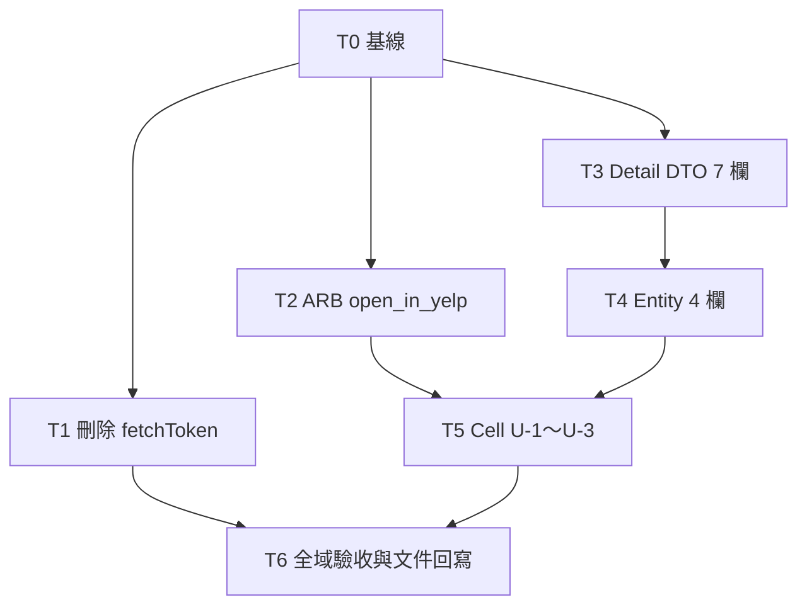

# 實作計畫：A-8.8 補齊 Detail DTO／Entity 欄位、資訊欄顯示 displayPhone／price／Yelp 連結、刪除 `fetchToken`

> 項目編號：**A-8.8（Detail 側；Summary 側已由 Issue #159／PR #160 完成）**
> 建立日期：2026-10-26
> 關聯規格：[`docs/features/2026-10-26-a-8-8-detail-entity-fields.md`](../features/2026-10-26-a-8-8-detail-entity-fields.md)（下稱「規格」，§、AC、D、R 編號沿用規格）
> 實查基線：`main` @ `b78a332`
> 狀態：草稿（STAGE 0b，第 1 次修正：回應 plan-verifier 初審的非阻擋觀察，並把 `_InfoLinkRow` 的 `Text` 改用 `Flexible` 包住）。規格 §7 的 D-1～D-4 已由使用者確認，本計畫不重新討論，只處理「怎麼做」

---

## 1. 簡介與目標

把 Yelp Business Details 已經回傳、但專案沒解析的欄位接進來，並清掉一支死碼：

1. `YelpRestaurantDetailDto` 新增 7 欄：`id`、`alias`、`price`、`url`、`displayPhone`、`isClaimed`、`transactions`。
2. `RestaurantDetailEntity` 新增 4 欄：`id`、`price`、`url`、`displayPhone`，`fromDto`／`toDto` 雙向對應。
3. `RestaurantInfoCell` 實作 U-1（電話顯示 `displayPhone`，撥號仍用 `phone`）、U-2（價位併入分類列最前面）、U-3（地址標題後的 Yelp 外開 icon；原「在 Yelp 開啟」列已於 T8 改掉）。
4. ARB 新增 `open_in_yelp`。
5. 刪除 `APIClz.fetchToken`。

不動 BLoC、Repository、頁面、Summary DTO、`Utils.openUrl`（規格 §5.2）。

---

## 2. 實作方向與 Trade-off

### 2.1 任務怎麼切

| 方向 | 作法 | 優點 | 缺點 |
|---|---|---|---|
| **A. 依層水平切，序列執行（採用）** | `fetchToken` → ARB → DTO → Entity → Cell → 文件，各一個任務 | 每個任務只碰一種產生器（retrofit／json_serializable 或 intl_utils），R-3 的產生碼漂移一眼就能定位到是哪個任務帶進來的。每個 commit 都能獨立通過 analyze 與 test | 任務數 7 個（含基線） |
| B. 一個任務做完 | 單一 commit | 總 diff 約 200 行，單人最省事 | 兩種產生器的輸出混在同一個 commit，AC-1 的「其他 `.g.dart` 不應有 diff」很難判斷是誰造成的；中途壞掉沒有檢查點 |
| C. 依欄位垂直切（`id`、`price`、`url`、`displayPhone` 各一條，從 DTO 一路做到 Cell） | 每條都是可展示的完整切片 | 每條都要改 DTO、Entity、Cell 三個檔案並重跑 `make gen`，同一檔案被寫 4 次 | — |

**選 A。** 判準是「每個共用檔只有一個寫入任務、每個產生器輸出只屬於一個任務」。

### 2.2 Cell 的「可點擊連結列」怎麼寫

U-3 要求「樣式比照電話列」，所以畫面上會有兩列結構完全相同的 `InkWell → Padding → Row(Icon, SizedBox, Text)`。

> **T8 後註記**：Yelp 列已改為地址標題後的 icon，`_InfoLinkRow` 只剩電話列使用，下表「兩列共用」的理由已不成立。仍保留它：改回 inline 會讓已約 185 行的 `build` 再多約 35 行，與 flutter-styles「Widget 提取」方向相反。

| 選項 | 作法 | 評估 |
|---|---|---|
| **(a) 抽出同檔私有 widget `_InfoLinkRow(icon, label, onTap)`，電話列與 Yelp 列共用（採用）** | 電話列原本的 34 行（`restaurant_info_cell.dart:123-156`）縮成 7 行，Yelp 列 6 行，新類別約 42 行 | 淨增約 21 行，比 (b) 少；樣式只有一份，兩列不會漂移。私有、同檔，不新增任何公開 API |
| (b) 把電話列的 `InkWell` 整段複製一份給 Yelp | 淨增約 33 行 | 兩份一模一樣的樣式碼，日後改一份忘一份 |
| (c) 輔助方法 `_buildLinkRow()` | — | 違反 flutter-styles「Widget 提取：禁止輔助方法」 |

順帶消掉電話列 `onTap` 內的冗餘判斷：原本外層 `if ((_detailInfo.phone ?? '').isNotEmpty)`（`:123`）已經擋掉空值，`:126-127` 在 `onTap` 內又檢查一次。改用 build 開頭的區域變數 `phone` 之後，兩處讀的是同一個值，內層判斷可以直接刪掉，行為不變。

**防禦性版面修正**：`_InfoLinkRow` 的 `Text` 以 `Flexible` 包住，容許換行，不做截斷。理由如下：

- 文字欄的寬度 = 螢幕寬 − 左右 padding 24 − 地圖 140 − 間距 12。以 320pt 寬的機型計算，只剩約 144pt；再扣掉 icon 與間距（21pt），文字只剩約 123pt。
- 現在的 `Row(mainAxisSize: min)` 內，`Text` 沒有寬度上限。較長的 `displayPhone`，例如國際格式 `+44 20 7946 0958`，以 14pt、w600 的字型會超過這個寬度，造成 RenderFlex overflow。
- 這個風險其實在現行的電話列就已經存在。本次把電話改成顯示可能更長的 `displayPhone`，所以一併處理。
- 選擇換行而不是截斷，是因為電話號碼被截掉一半就失去意義。
- 只有在原本會 overflow 的情況下才會換行；寬度足夠時，畫面和現在完全相同。
- 不更動規格鎖定的測試尺寸（AC-15 使用預設的 800×600），所以這項修正不新增窄螢幕測試。

### 2.3 格式化策略

實測（Dart 3.13.1）：本次要寫入的手寫檔中，有 2 個在基線就不符合 `dart format`：

| 檔案 | 基線差異位置 |
|---|---|
| `lib/features/component/cell/restaurant_detail/restaurant_info_cell.dart` | `:73-76`（`imageErrorBuilder`） |
| `test/component/restaurant_info_cell_test.dart` | `:95-122`（既有的靜態地圖測試） |

**決定：這 2 個檔案不整檔執行 `dart format`**。理由：

- 整檔格式化會把和本需求無關的 hunk 帶進 diff，其中一段還落在既有測試的本體內，和 AC-4「不改既有測試」的審查意圖衝突。
- CI（`.github/workflows/pr-check.yml:43,46`）只跑 `flutter analyze` 與 `flutter test`，沒有格式檢查，不整檔格式化不會讓 CI 失敗。

**計畫中的程式碼片段都是手寫的，一律以 `dart format` 的輸出為準。** 片段和 formatter 的結果不同時，採用 formatter 的結果，不必回頭修改本計畫。實際做法分兩種：

- 其他 4 個手寫 `.dart` 檔在基線就符合格式，所以直接執行 `dart format <檔案>`，結果就是 formatter 的版本。
- 上表 2 個檔案先執行 `dart format --output=show <檔案>`。**只把新增 hunk 的那幾段**照 formatter 的輸出改寫，基線那幾段維持原樣。

驗收方式（T5）：`dart format --output=show <檔案> | diff <檔案> -` 的輸出只能剩下上表的基線 hunk，加上檔尾那一行 `Formatted 1 file…` 訊息（`--output=show` 會把這行印到 stdout）。

### 2.4 已核對的關鍵事實

- **`make gen`**（`Makefile:58-59`）就是 `dart run build_runner build --delete-conflicting-outputs`。它同時跑 `json_serializable`、`retrofit_generator`、`flutter_gen_runner`（`pubspec.yaml:95-99`），所以也會重新產生 `lib/gen/assets.gen.dart`。基線必須先確認 `make gen` 不產生任何 diff（T0）。
- **`make intl`**（`Makefile:75-76`）就是 `dart run intl_utils:generate`。`flutter_intl` 沒有設定 `main_locale`（`pubspec.yaml:120-123`），所以預設是 `en`：
  - `l10n.dart` 的 getter 依 ARB 順序產生，新的 key 放在 ARB 最後，getter 就會接在 `review_summary_empty`（`l10n.dart:1414`）之後。
  - `messages_*.dart` 依 key 排序。
  - 兩者都只會是新增行。
- **ARB 檔尾沒有換行**（`}` 是最後一個字元）。編輯時維持原樣，避免多出一個無關的 hunk。
- **`fetchToken` 的範圍**：
  - 宣告在 `api_clz.dart:18-24`，`:25` 是空行。
  - 產生碼在 `api_clz.g.dart:25-66`（`@override` 到結尾的 `}`，再加 1 個空行，共 42 行）。
  - `lib/`、`test/` 沒有其他命中（已實測 `rtk proxy grep -rn -E "fetchToken|oauth2/token" lib test`，只有這 4 行）。
- **`RestaurantDetailEntity` 沒有覆寫 `==`**。`lib/`、`test/` 裡共 8 處建構（含 `registerFallbackValue(const RestaurantDetailEntity())`），全部使用具名參數或無參數。所以在建構式尾端加選填具名參數，不會影響任何呼叫點。
- **Detail DTO 不是 `explicitToJson`**，`toJson` 是淺層的。但它沒有呼叫點（規格 §1.1），本次不處理。
- **lint**：
  - `analysis_options.yaml` 把 `**/*.g.dart` 排除在 analyze 之外。
  - 有啟用 `prefer_const_constructors`、`prefer_const_declarations`、`prefer_single_quotes`、`unawaited_futures`。
  - `unawaited_futures` 只檢查 `async` 函式本體。所以 `onTap: () => launchUrl(...)` 這種寫法不會觸發，和現在 `:128` 的寫法等價。
- **`_Data`**：`test/domain_entity_test.dart` 和 `test/component/restaurant_info_cell_test.dart` 在基線都沒有 `_Data` 類別（已實查），所以 T4、T5 各自新增一個。
- **git 路徑**：git root 是 `Finding-Restaurant-Flutter/`，在本專案的上兩層。檔案清單比對一律使用 `git diff --name-only --relative` 搭配 `git ls-files --others --exclude-standard`，沿用 `2026-10-23-yelp-places-api-coverage.md` §2.3 的作法。

---

## 3. 資料結構

資料流不變：Yelp JSON → `YelpRestaurantDetailDto` → `RestaurantDetailEntity.fromDto` → `RestaurantInfoCell`。本次沒有新增任何轉換層。

| JSON key | DTO 欄位（附加在 `hours` 之後） | Entity 欄位（附加在 `hours` 之後） | Cell 用途 |
|---|---|---|---|
| `id` | `String? id` | `final String? id` | 無 |
| `alias` | `String? alias` | — | 無 |
| `price` | `String? price` | `final String? price` | 分類列的第一個元素（U-2） |
| `url` | `String? url` | `final String? url` | 地址標題後的 Yelp 外開 icon（U-3） |
| `display_phone` | `String? displayPhone` | `final String? displayPhone` | 電話列的顯示文字（U-1） |
| `is_claimed` | `bool? isClaimed` | — | 無 |
| `transactions` | `List<String>? transactions` | — | 無 |

**新欄位一律附加在既有欄位之後**，DTO 與 Entity 都一樣，沿用 PR #160 擴充 Summary DTO 時的做法（`yelp_restaurant_summary_dto.dart:26-38`）。這樣做的效果：

- 既有的每一行都不移動。
- `yelp_restaurant_detail_dto.g.dart` 的 diff 只有新增行，刪除行數為 0。AC-1 可以直接用 `git diff --numstat` 機械驗證。

DTO 不加 `@JsonKey(includeIfNull: false)`，也不加 `defaultValue`（規格 §3.1）。

---

## 4. 檔案異動清單

| 檔案 | 類型 | 任務 |
|---|---|---|
| `lib/api/api_clz.dart` | 手寫，修改（刪 8 行） | T1 |
| `lib/api/api_clz.g.dart` | **生成碼**（`make gen`） | T1 |
| `lib/l10n/intl_en.arb` | 手寫，修改 | T2 |
| `lib/l10n/intl_zh_TW.arb` | 手寫，修改 | T2 |
| `lib/generated/l10n.dart` | **生成碼**（`make intl`） | T2 |
| `lib/generated/intl/messages_en.dart` | **生成碼**（`make intl`） | T2 |
| `lib/generated/intl/messages_zh_TW.dart` | **生成碼**（`make intl`） | T2 |
| `lib/api/dto/yelp_restaurant_detail_dto.dart` | 手寫，修改 | T3 |
| `lib/api/dto/yelp_restaurant_detail_dto.g.dart` | **生成碼**（`make gen`） | T3 |
| `test/api/dto/yelp_restaurant_detail_dto_test.dart` | 手寫，**新增** | T3 |
| `lib/domain/entities/restaurant_detail_entity.dart` | 手寫，修改 | T4 |
| `test/domain_entity_test.dart` | 手寫，修改（只新增） | T4 |
| `lib/features/component/cell/restaurant_detail/restaurant_info_cell.dart` | 手寫，修改 | T5 |
| `test/component/restaurant_info_cell_test.dart` | 手寫，修改（只新增） | T5 |
| `docs/brainstorm/2026-10-26-features-brainstorm.md` | 文件，修改 1 行（`:1638`）。STAGE 4 會在同一行補上 PR 編號（見 T6 步驟 4） | T6 |

共 15 個檔案，其中 5 個是生成碼（即 §5.2 標 ★ 的 5 個）。

**不動**：

- 程式：`pubspec.yaml`、`pubspec.lock`、`lib/gen/assets.gen.dart`、`lib/generated/intl/messages_all.dart`、所有其他 `.g.dart`、`yelp_restaurant_summary_dto.dart`、`utils.dart`、`restaurant_detail_repo.dart`、`restaurant_detail_page.dart`。
- `docs/architecture/`：
  - 依規格 §5.2，不回頭修改。
  - 知會一件事：`overview.md:141-142` 引用的 `api_clz.dart:57`／`:71`，從 PR #160 起就已經和實際行號不符。T1 刪掉 8 行後還會再位移，但修正它屬於文件維護，不在本次範圍。

---

## 5. 任務拆分

### 5.0 共通流程

**執行環境**：

- STAGE 1 會建立專屬的 worktree 與 feature branch，並把規格與本計畫 commit 進去。
- STAGE 2 在該 worktree 內依序執行任務，每個任務驗收通過後由 workflow commit（gen-commit）。
- 下文的「基線」指的是**上一個任務的 commit（`HEAD`）**。

**每個任務都照這個流程**：

1. **先寫測試**，執行後確認是紅燈。
   - 通常是編譯失敗，因為欄位或 getter 還不存在。
   - T5 例外：前置任務已經完成，測試可以編譯，只有 4 個測試會紅。逐項說明見 T5 步驟 1。
   - T1、T2、T6 沒有新測試，紅燈改用任務內指定的 grep 證據。
2. 實作。計畫中的程式碼片段以 `dart format` 的輸出為準（§2.3）。
3. 需要時重新產生程式碼：
   - 修改了 `@JsonSerializable` 或 `@RestApi` 來源的任務，執行 `make gen`。
   - 修改了 ARB 的任務，執行 `make intl`。
   - 生成碼和它的來源檔放在同一個任務、同一個 commit。
4. 驗收（基線為 `HEAD`）：

   ```bash
   dart format <本任務寫入的手寫 .dart 檔；排除 *.g.dart、lib/generated/，以及 §2.3 那 2 個檔案>
   flutter analyze                     # 預期：No issues found!
   flutter test <本任務的測試檔>         # 預期：全綠
   flutter test                        # 預期：全綠；通過數 = 上一個 commit 的通過數 + 本任務新增的 test 數
   { git diff --name-only --relative HEAD; git ls-files --others --exclude-standard; } | sort
                                       # 預期：恰好是本任務「寫入檔案」列出的路徑，不多不少
   ```

5. 驗收通過後由 workflow commit。記下這次 `flutter test` 的通過數，交給下一個任務比對。

### 5.1 相依圖與並行性



- **T1、T2、T3 彼此沒有相依，寫入路徑也互不重疊。**
  - 但 T1 與 T3 都要執行 `make gen`。`build_runner` 每次都會掃描整個 package：兩者若同時在同一個 worktree 執行，會搶 `.dart_tool/build`；而且先跑的那一個會順手重新產生另一個任務的 `.g.dart`，破壞「生成碼只屬於一個任務」的切分。所以 **T1 與 T3 不可同時執行**。
  - T2 只執行 `make intl`，輸出在 `lib/generated/`，和 `build_runner` 互不干擾。所以 **T2 可以和 T1 或 T3 並行**。
- **T3 → T4**：Entity 的 `fromDto`／`toDto` 讀寫 DTO 的新欄位。T4 需要 T3 的 DTO 原始碼與重新產生的 `.g.dart` 都已經 commit。
- **T2、T4 → T5**：Cell 需要 `S.current.open_in_yelp`（來自 T2）和 Entity 的新欄位（來自 T4）。
- **T1、T5 → T6**：T6 是全域驗收，必須在所有程式改動完成之後執行。

**建議執行順序**：T0 → T1 → T2 → T3 → T4 → T5 → T6，全部序列。每個任務只需要 5～15 分鐘，並行省下的時間不值得承擔 §5.0 檔案清單比對混在一起的風險。

### 5.2 任務總表

| 編號 | 標題 | 寫入檔案（★ = 生成碼） | 前置 | 可否並行 | 新增 test 數 | 預估 |
|---|---|---|---|---|---|---|
| T0 | 基線 | 無 | — | — | 0 | 5 分 |
| T1 | 刪除 `fetchToken` | `api_clz.dart`、★`api_clz.g.dart` | T0 | 可與 T2 並行；**不可與 T3 並行**（都跑 `make gen`） | 0 | 5 分 |
| T2 | ARB `open_in_yelp` | 2 個 ARB、★`l10n.dart`、★`messages_en.dart`、★`messages_zh_TW.dart` | T0 | 可與 T1 或 T3 並行 | 0 | 5 分 |
| T3 | Detail DTO 新增 7 欄 | `yelp_restaurant_detail_dto.dart`、★`.g.dart`、新的 DTO test | T0 | 可與 T2 並行；**不可與 T1 並行** | 2 | 8 分 |
| T4 | Entity 新增 4 欄 | `restaurant_detail_entity.dart`、`domain_entity_test.dart` | T3 | 否 | 3 | 6 分 |
| T5 | Cell 實作 U-1～U-3 | `restaurant_info_cell.dart`、`restaurant_info_cell_test.dart` | T2、T4 | 否 | 9 | 15 分 |
| T6 | 全域驗收與文件回寫 | `docs/brainstorm/2026-10-26-features-brainstorm.md` | T1、T5 | 否 | 0 | 8 分 |

新增 test 合計 **14 個**。

---

### T0：基線（5 分）

前提：STAGE 1 已經建立 worktree，並 commit 了規格與本計畫。

```bash
flutter pub get                          # 新 worktree 沒有 .dart_tool；不應改動 pubspec.lock
git status --porcelain -- .              # 預期：無輸出
make gen
make intl
git status --porcelain -- .              # 預期：仍然無輸出（現有的 .g.dart、assets.gen.dart、lib/generated 都和來源一致）
flutter analyze                          # 記錄：No issues found!
flutter test 2>&1 | tail -1              # 記錄通過數 N0
rtk proxy grep -rn -E "fetchToken|oauth2/token" lib test   # 記錄：恰好 4 行（api_clz.dart:18,20；api_clz.g.dart:26,50）
```

如果第二次 `git status` 有輸出，代表產生器版本有漂移（R-3）。這時**停止執行**，回報漂移的檔案清單，不要繼續 T1。

T0 不寫入任何檔案，不 commit。

---

### T1：刪除 `fetchToken`（5 分）

- **寫入檔案**：`lib/api/api_clz.dart`、`lib/api/api_clz.g.dart`（★生成碼）
- **對應 AC**：AC-1（`api_clz.g.dart` 部分）、AC-5

**步驟 1：紅燈證據**

執行 T0 的最後一條 grep，預期有 4 行命中。

**步驟 2：實作**

刪掉 `api_clz.dart:18-25`，也就是宣告本體加上後面那一個空行：

```dart
  @POST('/oauth2/token')
  @FormUrlEncoded()
  Future<String> fetchToken(
    @Field('grant_type') String? grantType,
    @Field('client_id') String? clientId,
    @Field('client_secret') String? clientSecret,
  );

```

刪除後，`factory APIClz(...)`（`:16`）與 `@GET('/v3/businesses/search')` 之間只留一個空行。

**步驟 3**：`make gen`

**步驟 4：驗收**

先跑 §5.0 的共通驗收，再加上：

```bash
rtk proxy grep -rn -E "fetchToken|oauth2/token" lib test        # 預期：無輸出（AC-5）
git diff --numstat --relative HEAD
# 預期恰好兩行，且新增行數都是 0：
#   0  8   lib/api/api_clz.dart
#   0  42  lib/api/api_clz.g.dart    （刪除行數以實際為準，但新增行數必須是 0）
```

`flutter test` 的通過數應該等於 N0。

---

### T2：ARB 新增 `open_in_yelp`（5 分）

- **寫入檔案**：
  - `lib/l10n/intl_en.arb`
  - `lib/l10n/intl_zh_TW.arb`
  - `lib/generated/l10n.dart`（★）
  - `lib/generated/intl/messages_en.dart`（★）
  - `lib/generated/intl/messages_zh_TW.dart`（★）
- **對應 AC**：AC-2

**步驟 1：紅燈證據**

```bash
rtk proxy grep -rn "open_in_yelp" lib    # 預期：無輸出
```

**步驟 2：實作**

在兩個 ARB 的最後一個 key 後面新增一行。前一行要補上逗號，檔尾維持沒有換行：

```json
  "review_summary_empty": "No review summary available",
  "open_in_yelp": "Open in Yelp"
}
```

```json
  "review_summary_empty": "暫無評論情報",
  "open_in_yelp": "在 Yelp 開啟"
}
```

**步驟 3**：`make intl`

**步驟 4：驗收**

先跑 §5.0 的共通驗收，再加上：

```bash
rtk proxy grep -rn "open_in_yelp" lib/generated
# 預期：l10n.dart（getter 與 name:）、messages_en.dart、messages_zh_TW.dart 都有命中
git diff --numstat --relative HEAD
# 預期恰好 5 行：
#   兩個 ARB 各是「2 新增、1 刪除」
#   lib/generated 的 3 個檔案，刪除行數都是 0
```

`flutter test` 的通過數應該維持不變。

---

### T3：`YelpRestaurantDetailDto` 新增 7 欄（8 分）

- **寫入檔案**：
  - `lib/api/dto/yelp_restaurant_detail_dto.dart`
  - `lib/api/dto/yelp_restaurant_detail_dto.g.dart`（★）
  - `test/api/dto/yelp_restaurant_detail_dto_test.dart`（新增）
- **對應 AC**：AC-1（DTO `.g.dart` 部分）、AC-7、AC-8

**步驟 1：先寫測試**

新增 `test/api/dto/yelp_restaurant_detail_dto_test.dart`，比照 `yelp_restaurant_summary_dto_test.dart` 的寫法，測資放在 `_Data`：

```dart
import 'package:flutter_restaruant/api/dto/dto_barrel.dart';
import 'package:flutter_test/flutter_test.dart';

class _Data {
  static const Map<String, dynamic> business = {
    'id': 'WavvLdfdP6g8aZTtbBQHTw',
    'alias': 'gary-danko-san-francisco',
    'name': 'Gary Danko',
    'price': '\$\$\$\$',
    'url': 'https://www.yelp.com/biz/gary-danko-san-francisco',
    'phone': '+14157492060',
    'display_phone': '(415) 749-2060',
    'is_claimed': true,
    'transactions': ['pickup', 'delivery'],
  };
}

void main() {
  group('YelpRestaurantDetailDto 新增欄位', () {
    test('完整測資逐欄解析，既有欄位不受影響', () {
      final dto = YelpRestaurantDetailDto.fromJson(_Data.business);
      expect(dto.id, 'WavvLdfdP6g8aZTtbBQHTw');
      expect(dto.alias, 'gary-danko-san-francisco');
      expect(dto.price, '\$\$\$\$');
      expect(dto.url, 'https://www.yelp.com/biz/gary-danko-san-francisco');
      expect(dto.displayPhone, '(415) 749-2060');
      expect(dto.isClaimed, isTrue);
      expect(dto.transactions, ['pickup', 'delivery']);
      expect(dto.name, 'Gary Danko');
      expect(dto.phone, '+14157492060');
    });

    test('缺欄位時 7 個新欄位皆為 null', () {
      final dto = YelpRestaurantDetailDto.fromJson(const {'name': 'x'});
      expect(dto.id, isNull);
      expect(dto.alias, isNull);
      expect(dto.price, isNull);
      expect(dto.url, isNull);
      expect(dto.displayPhone, isNull);
      expect(dto.isClaimed, isNull);
      expect(dto.transactions, isNull);
    });
  });
}
```

執行 `flutter test test/api/dto/yelp_restaurant_detail_dto_test.dart`，預期紅燈（編譯失敗：getter 不存在）。

**步驟 2：實作**

在 `yelp_restaurant_detail_dto.dart` 的欄位區（`:21` 的 `hours` 之後）新增：

```dart
  List<YelpRestaurantHoursDto>? hours;
  String? id;
  String? alias;
  String? price;
  String? url;
  String? displayPhone;
  bool? isClaimed;
  List<String>? transactions;
```

建構式（`:34` 的 `this.hours,` 之後）新增：

```dart
    this.hours,
    this.id,
    this.alias,
    this.price,
    this.url,
    this.displayPhone,
    this.isClaimed,
    this.transactions,
  });
```

`@JsonSerializable(fieldRename: FieldRename.snake)`、`fromJson`、`toJson` 都不動。

**步驟 3**：`make gen`

**步驟 4：驗收**

先跑 §5.0 的共通驗收，再加上：

```bash
# 1. 方向：只有新增（AC-1）
git diff --numstat --relative HEAD -- lib/api/dto/yelp_restaurant_detail_dto.g.dart
# 預期：第 2 欄（刪除行數）是 0

# 2. 內容：每一個新增行都對應到 7 個 key／欄位之一（AC-1）
git diff -U0 --relative HEAD -- lib/api/dto/yelp_restaurant_detail_dto.g.dart | rtk proxy grep '^+[^+]'
```

第 2 條指令預期**恰好輸出下列 16 行**：

- fromJson 7 個欄位，其中 `transactions` 由 formatter 折成 3 行，所以共 9 行。
- toJson 7 個 key，共 7 行。
- 順序可能因為 diff 的對齊方式而略有位移，但這 16 行的內容必須一字不差，而且不能有其他新增行。

```text
+  id: json['id'] as String?,
+  alias: json['alias'] as String?,
+  price: json['price'] as String?,
+  url: json['url'] as String?,
+  displayPhone: json['display_phone'] as String?,
+  isClaimed: json['is_claimed'] as bool?,
+  transactions: (json['transactions'] as List<dynamic>?)
+      ?.map((e) => e as String)
+      .toList(),
+  'id': instance.id,
+  'alias': instance.alias,
+  'price': instance.price,
+  'url': instance.url,
+  'display_phone': instance.displayPhone,
+  'is_claimed': instance.isClaimed,
+  'transactions': instance.transactions,
```

`transactions` 的 3 行折法，比照 Summary DTO 產生碼的寫法（`yelp_restaurant_summary_dto.g.dart:38-40`）。

`flutter test` 的通過數應該是 N0 + 2。

---

### T4：`RestaurantDetailEntity` 新增 4 欄（6 分）

- **寫入檔案**：`lib/domain/entities/restaurant_detail_entity.dart`、`test/domain_entity_test.dart`
- **對應 AC**：AC-9、AC-10、AC-11

**步驟 1：先寫測試**

`test/domain_entity_test.dart` 只做新增，既有的 test 一行都不改：

- 在 `void main()`（`:6`）之前新增 `_Data`。基線沒有這個類別。
- 在既有 group 內、`:65`（既有 Detail test 的結尾）之後新增 3 個 test。
- 重複出現的測資都放進 `_Data` 的 `static const`（flutter-styles §8.2）。

```dart
class _Data {
  static const String id = 'bistro-101-id';
  static const String alias = 'bistro-101';
  static const String price = '\$\$';
  static const String url = 'https://www.yelp.com/biz/bistro-101';
  static const String displayPhone = '(02) 2345-6789';
  static const List<String> transactions = ['delivery'];
}
```

```dart
    test('RestaurantDetailEntity.fromDto maps id/price/url/displayPhone', () {
      final entity = RestaurantDetailEntity.fromDto(
        YelpRestaurantDetailDto(
          id: _Data.id,
          price: _Data.price,
          url: _Data.url,
          displayPhone: _Data.displayPhone,
        ),
      );

      expect(entity.id, _Data.id);
      expect(entity.price, _Data.price);
      expect(entity.url, _Data.url);
      expect(entity.displayPhone, _Data.displayPhone);
    });

    test('RestaurantDetailEntity.toDto writes back the 4 fields only', () {
      final dto = RestaurantDetailEntity.fromDto(
        YelpRestaurantDetailDto(
          id: _Data.id,
          alias: _Data.alias,
          price: _Data.price,
          url: _Data.url,
          displayPhone: _Data.displayPhone,
          isClaimed: true,
          transactions: _Data.transactions,
        ),
      ).toDto;

      expect(dto.id, _Data.id);
      expect(dto.price, _Data.price);
      expect(dto.url, _Data.url);
      expect(dto.displayPhone, _Data.displayPhone);
      // 刻意有損（規格 §3.1）：Entity 不攜帶這 3 欄。
      expect(dto.alias, isNull);
      expect(dto.isClaimed, isNull);
      expect(dto.transactions, isNull);
    });

    test('Empty DTO leaves the 4 new entity fields null', () {
      final entity = RestaurantDetailEntity.fromDto(YelpRestaurantDetailDto());

      expect(entity.id, isNull);
      expect(entity.price, isNull);
      expect(entity.url, isNull);
      expect(entity.displayPhone, isNull);
    });
```

AC-10 的來源 DTO 刻意帶上 `alias`、`isClaimed`、`transactions`。這樣「`toDto` 之後是 null」才證明了 Entity 確實沒有攜帶這 3 欄；如果來源本來就是 null，這個斷言什麼都證明不了。

執行 `flutter test test/domain_entity_test.dart`，預期紅燈（編譯失敗）。

**步驟 2：實作**（`restaurant_detail_entity.dart`，四處都是附加在 `hours` 之後）

```dart
  // 欄位（:18 之後）
  final List<RestaurantHoursEntity>? hours;
  final String? id;
  final String? price;
  final String? url;
  final String? displayPhone;

  // const 建構式（:31 的 this.hours, 之後）
    this.hours,
    this.id,
    this.price,
    this.url,
    this.displayPhone,
  });

  // fromDto（:52 的 hours: ... 之後）
        hours: dto.hours?.map((e) => RestaurantHoursEntity.fromDto(e)).toList(),
        id: dto.id,
        price: dto.price,
        url: dto.url,
        displayPhone: dto.displayPhone,
      );

  // toDto（:66 的 hours: ... 之後）
    hours: hours?.map((e) => e.toDto).toList(),
    id: id,
    price: price,
    url: url,
    displayPhone: displayPhone,
  );
```

**步驟 3：驗收**

先跑 §5.0 的共通驗收，再加上：

```bash
git diff --numstat --relative HEAD -- test/domain_entity_test.dart
# 預期：第 2 欄（刪除行數）是 0，代表只有新增。
# 用 numstat 而不用 grep '^-'：後者抓不到被刪掉的空行，也會誤判以 '-' 開頭的內容。
```

`flutter test` 的通過數應該是 N0 + 5。

---

### T5：`RestaurantInfoCell` 實作 U-1～U-3（15 分）

- **寫入檔案**：
  - `lib/features/component/cell/restaurant_detail/restaurant_info_cell.dart`
  - `test/component/restaurant_info_cell_test.dart`
- **對應 AC**：AC-4、AC-12～AC-16，以及 AC-18 的機械部分

**步驟 1：先寫測試**

`test/component/restaurant_info_cell_test.dart` 只做新增：

- 在 `void main()`（`:9`）之前新增 `_Data`。基線沒有這個類別。
- 在 group 的結尾 `  });`（`:125`）之前新增 9 個 `testWidgets`。
- 在檔案最後新增 1 個 top-level 的 pump helper。
- 既有的 3 個 test 一字不改。`:36` 的 `find.text('+886212345678')` 與 `:37` 的 `find.text('咖啡廳')` 原樣保留，作為 U-1 回退（`displayPhone` 為 null）與 U-2（`price` 為 null）的回歸測試（AC-4）。既有測試裡的字面值也不改成 `_Data`。
- 所有測試都**不點擊**電話列和 Yelp 列（AC-16，理由見規格 R-1）。

```dart
class _Data {
  static const String phone = '+14157492060';
  static const String displayPhone = '(415) 749-2060';
  static const String price = '\$\$';
  static const String cafe = '咖啡廳';
  static const String yelpUrl =
      'https://www.yelp.com/biz/gary-danko-san-francisco';
}
```

```dart
    testWidgets('displayPhone 非空時電話列顯示 displayPhone', (tester) async {
      await _pumpCell(
        tester,
        const RestaurantDetailEntity(
          phone: _Data.phone,
          displayPhone: _Data.displayPhone,
        ),
      );

      expect(find.text(_Data.displayPhone), findsOneWidget);
      expect(find.text(_Data.phone), findsNothing);
    });

    testWidgets('displayPhone 為空字串時回退顯示 phone', (tester) async {
      await _pumpCell(
        tester,
        const RestaurantDetailEntity(phone: _Data.phone, displayPhone: ''),
      );

      expect(find.text(_Data.phone), findsOneWidget);
    });

    testWidgets('phone 為空時即使有 displayPhone 也不顯示電話列', (tester) async {
      await _pumpCell(
        tester,
        const RestaurantDetailEntity(displayPhone: _Data.displayPhone),
      );

      expect(find.text(_Data.displayPhone), findsNothing);
    });

    testWidgets('價位併入分類列最前面', (tester) async {
      await _pumpCell(
        tester,
        const RestaurantDetailEntity(
          price: _Data.price,
          categories: [RestaurantCategoryEntity(title: _Data.cafe)],
        ),
      );

      expect(find.text('${_Data.price} · ${_Data.cafe}'), findsOneWidget);
    });

    testWidgets('無分類時分類列只顯示價位', (tester) async {
      await _pumpCell(tester, const RestaurantDetailEntity(price: _Data.price));

      expect(find.text(_Data.price), findsOneWidget);
    });

    testWidgets('price 為空字串時分類列與現行一致', (tester) async {
      await _pumpCell(
        tester,
        const RestaurantDetailEntity(
          price: '',
          categories: [RestaurantCategoryEntity(title: _Data.cafe)],
        ),
      );

      expect(find.text(_Data.cafe), findsOneWidget);
    });

    testWidgets('url 非空時顯示「在 Yelp 開啟」', (tester) async {
      await _pumpCell(tester, const RestaurantDetailEntity(url: _Data.yelpUrl));

      expect(find.text(S.current.open_in_yelp), findsOneWidget);
    });

    testWidgets('url 為 null 或空字串時不顯示「在 Yelp 開啟」', (tester) async {
      await _pumpCell(tester, const RestaurantDetailEntity());
      expect(find.text(S.current.open_in_yelp), findsNothing);

      await _pumpCell(tester, const RestaurantDetailEntity(url: ''));
      expect(find.text(S.current.open_in_yelp), findsNothing);
    });

    testWidgets('新欄位全有值且分類多到截斷時不 overflow', (tester) async {
      await _pumpCell(
        tester,
        RestaurantDetailEntity(
          id: 'gary-danko-id',
          phone: _Data.phone,
          displayPhone: _Data.displayPhone,
          price: _Data.price,
          url: _Data.yelpUrl,
          categories: List.generate(
            20,
            (i) => RestaurantCategoryEntity(title: 'Category $i'),
          ),
          location: const RestaurantLocationEntity(
            displayAddress: ['800 N Point St, San Francisco, CA 94109'],
          ),
        ),
      );

      expect(tester.takeException(), isNull);
    });
```

檔案最後的 helper。它只給新的 test 使用，既有的 3 個 test 不改成呼叫它：

```dart
Future<void> _pumpCell(WidgetTester tester, RestaurantDetailEntity detail) =>
    tester.pumpWidget(
      MaterialApp(
        theme: AppThemeData.materialLight,
        localizationsDelegates: const [S.delegate],
        home: Scaffold(
          body: RestaurantInfoCell(detailInfo: detail, staticMapUrl: ''),
        ),
      ),
    );
```

- 測試畫面使用預設的測試尺寸 800×600（AC-15）。
- 20 個分類以 `fontSize12` 串接後，寬度遠超過文字欄約 624 px 的寬度，一定會觸發 `maxLines: 1` 的省略號。

執行 `flutter test test/component/restaurant_info_cell_test.dart`。T2、T4 已經完成，所以測試可以編譯，紅燈來自斷言失敗。預期結果是 `+8 -4`：

**實作前必須紅（4 個）**，它們驗證的是新行為：

| test | 實作前為何失敗 |
|---|---|
| `displayPhone 非空時電話列顯示 displayPhone` | 現行的電話列顯示 `phone`，找不到 `displayPhone` |
| `價位併入分類列最前面` | 現行的分類列只有 `咖啡廳`，找不到 `$$ · 咖啡廳` |
| `無分類時分類列只顯示價位` | 現行沒有分類時，分類列不顯示，找不到 `$$` |
| `url 非空時顯示「在 Yelp 開啟」` | 現行沒有 Yelp 列 |

**實作前就是綠（5 個）**，這是預期的結果，它們是**回歸防護**，用來鎖住實作不能破壞現行行為或規格的邊界：

| test | 防護什麼 |
|---|---|
| `displayPhone 為空字串時回退顯示 phone` | U-1 的回退：空字串不能蓋掉 `phone` |
| `phone 為空時即使有 displayPhone 也不顯示電話列` | D-3：電話列是否顯示只看 `phone` |
| `price 為空字串時分類列與現行一致` | U-2：空的價位不能多出前導的 ` · ` |
| `url 為 null 或空字串時不顯示「在 Yelp 開啟」` | U-3：沒有連結就沒有入口 |
| `新欄位全有值且分類多到截斷時不 overflow` | AC-15：新增的列不能造成 overflow |

只要上面 4 個之外有任何一個紅，或這 4 個裡有任何一個綠，都代表測試本身寫錯了。這時要先修測試，再進入實作。

**步驟 2：實作**（`restaurant_info_cell.dart`。以下片段以 `dart format` 的輸出為準，見 §2.3）

**(1) `:31-36` 分類字串**，改成以下內容，並在前面加上 3 個區域變數：

```dart
    final String phone = _detailInfo.phone ?? '';
    final String displayPhone = _detailInfo.displayPhone ?? '';
    final String url = _detailInfo.url ?? '';
    // 價位放最前面：分類列 maxLines 為 1，尾端的分類會先被截掉。
    final String category = [
      _detailInfo.price ?? '',
      ...?_detailInfo.categories?.map((category) => category.title ?? ''),
    ].where((part) => part.isNotEmpty).join(' · ');
```

`price` 為 null 或空字串時，它在 `where` 就被濾掉了。結果和現在的寫法逐字相同，所以既有測試 `:37` 不受影響，也不需要新增任何 `if`（D-1）。

**(2) `:123-156` 電話列**，整段替換為以下兩列：

```dart
                  if (phone.isNotEmpty)
                    _InfoLinkRow(
                      icon: Icons.phone_outlined,
                      // 撥號一律用 phone；displayPhone 含空白與括號，只負責顯示。
                      label: displayPhone.isEmpty ? phone : displayPhone,
                      onTap: () => launchUrl(Uri.parse('tel://$phone')),
                    ),
                  if (url.isNotEmpty)
                    _InfoLinkRow(
                      icon: Icons.open_in_new,
                      label: S.current.open_in_yelp,
                      onTap: () => Utils.openUrl(rawUrl: url),
                    ),
```

- 電話列是否顯示，仍然只看 `phone`（D-3、規格 U-1 表第 3 列）。
- Yelp 連結走既有的 `Utils.openUrl(rawUrl:)`，沒有新增其他的 launch 路徑（AC-18）。

**(3) 檔案最後**，在 `RestaurantInfoCell` 類別之後新增私有 widget。它的樣式和原本電話列的 `InkWell` 逐項相同（`:124-155`），唯一的差別是 `Text` 外面多包了一層 `Flexible`（§2.2 的防禦性版面修正）：

```dart
class _InfoLinkRow extends StatelessWidget {
  final IconData icon;
  final String label;
  final VoidCallback onTap;

  const _InfoLinkRow({
    required this.icon,
    required this.label,
    required this.onTap,
  });

  @override
  Widget build(BuildContext context) {
    final colorScheme = Theme.of(context).colorScheme;
    return InkWell(
      onTap: onTap,
      borderRadius: BorderRadius.circular(ThemeSize.radius8),
      child: Padding(
        padding: const EdgeInsets.symmetric(vertical: ThemeSize.space3),
        child: Row(
          mainAxisSize: MainAxisSize.min,
          children: <Widget>[
            Icon(icon, size: ThemeSize.size16, color: colorScheme.primary),
            const SizedBox(width: ThemeSize.space5),
            // 窄螢幕下較長的 displayPhone 改為換行，避免 Row 溢出。
            Flexible(
              child: Text(
                label,
                style: TextStyle(
                  color: colorScheme.primary,
                  fontWeight: FontWeight.w600,
                  fontSize: ThemeFontSize.fontSize14,
                ),
              ),
            ),
          ],
        ),
      ),
    );
  }
}
```

- `Flexible` 使用預設的 `FlexFit.loose`。在 `MainAxisSize.min` 的 `Row` 裡，文字寬度足夠時，版面和沒有 `Flexible` 時完全相同。
- 這個 `Row` 的上層是 `Expanded` 內的 `Column`，寬度有上限，所以 `Flexible` 拿得到有限的約束，不會出現 unbounded 錯誤。

參數全部用具名參數：`icon` 和 `label` 同樣都是核心資料，沒有哪一個是「唯一的核心值」。加上參數有 3 個，依 flutter-styles §2.8 應該使用具名參數。

**步驟 3：驗收**

先跑 §5.0 的共通驗收（這 2 個檔案不整檔執行 `dart format`，見 §2.3），再加上：

```bash
flutter test test/component/restaurant_info_cell_test.dart      # 預期：12 個全綠（既有 3 個 + 新增 9 個）

# 既有測試一行未刪（AC-4）
git diff --numstat --relative HEAD -- test/component/restaurant_info_cell_test.dart
# 預期：第 2 欄（刪除行數）是 0

# 新程式碼符合格式：輸出只能剩下 §2.3 的基線 hunk 與檔尾的 Formatted 訊息行
for f in lib/features/component/cell/restaurant_detail/restaurant_info_cell.dart \
         test/component/restaurant_info_cell_test.dart; do
  echo "== $f"; dart format --output=show "$f" | diff "$f" - | rtk proxy grep '^[0-9]'
done
# 預期：
#   cell：imageErrorBuilder 那一段（基線 :73-76，因上方新增 2 行而變成 :75-78）＋ 檔尾的 Formatted 行
#   test：既有靜態地圖測試那幾段（基線 :95-122，內容不變，行號隨檔首新增的 _Data 一起下移）＋ 檔尾的 Formatted 行

# AC-18 的機械部分：撥號 URI 由 phone 組成；Yelp 連結走 Utils.openUrl
rtk proxy grep -n -E "tel://|launchUrl\(|Utils\.openUrl\(" lib/features/component/cell/restaurant_detail/restaurant_info_cell.dart
# 預期：恰好 4 行
#   1 行：onTap: () => launchUrl(Uri.parse('tel://$phone'))（tel:// 與 launchUrl( 在同一行）
#   3 行：Utils.openUrl(（Google Maps 2 處 + Yelp 1 處）
```

`flutter test` 的通過數應該是 N0 + 14。

---

### T6：全域驗收與文件回寫（8 分）

- **寫入檔案**：`docs/brainstorm/2026-10-26-features-brainstorm.md`，只改 `:1638` 這一行。
- **對應 AC**：AC-1～AC-6 的全域複核；AC-17、AC-18 的人工清單；規格 §5.1 的文件同步。

**步驟 1：全域驗收**

前提是 T1～T5 都已經 commit。`BASE` 是本 branch 從 `main` 分出的那個 commit。

```bash
BASE=$(git merge-base HEAD main)

# 1. 產生碼與來源一致（AC-1、AC-2）
git status --porcelain -- .                 # 預期：無輸出
make gen && make intl
git status --porcelain -- .                 # 預期：仍然無輸出

# 2. 生成碼的 diff 範圍（AC-1、AC-2）
git diff --numstat --relative "$BASE" -- '*.g.dart' lib/generated
# 預期恰好 5 行：
#   api_clz.g.dart：新增 0
#   yelp_restaurant_detail_dto.g.dart：刪除 0
#   lib/generated 的 3 個檔案：刪除 0
#   不能出現其他任何 .g.dart

# 3. 格式：只檢查格式乾淨的手寫檔（§2.3 那 2 個檔案已經在 T5 檢查過）
dart format --output=none --set-exit-if-changed \
  lib/api/api_clz.dart \
  lib/api/dto/yelp_restaurant_detail_dto.dart \
  lib/domain/entities/restaurant_detail_entity.dart \
  test/api/dto/yelp_restaurant_detail_dto_test.dart \
  test/domain_entity_test.dart              # 預期：exit 0

# 4. 靜態分析與測試（AC-3、AC-4）
flutter analyze                             # 預期：No issues found!
flutter test                                # 預期：全綠，通過數 = N0 + 14

# 5. 死碼與相依（AC-5、AC-6）
rtk proxy grep -rn -E "fetchToken|oauth2/token" lib test       # 預期：無輸出
git diff --stat "$BASE" -- pubspec.yaml pubspec.lock            # 預期：無輸出

# 6. 範圍：用 --name-only 列出完整路徑（--stat 會截斷長路徑）
git diff --name-only --relative "$BASE" -- lib test | sort
# 預期：恰好是 §4 列出的 14 個 lib/test 路徑，不多不少
```

**步驟 2：文件回寫（STAGE 2，先寫 Issue 編號）**

把 `docs/brainstorm/2026-10-26-features-brainstorm.md:1638` 整行替換。括號的寫法比照同一份文件的既有慣例 `(Issue #N / PR #N)`（例如 `:1932`）。PR 編號在這個時間點還不存在，所以這一步只寫 Issue：

```markdown
- **狀態**：✅ 已於 <執行日> 完成 (Issue #<n>)。Summary 側先前已於 Issue #159 / PR #160 完成；本次完成 Detail 側：`YelpRestaurantDetailDto` 補上 `id`、`alias`、`price`、`url`、`display_phone`、`is_claimed`、`transactions`；`RestaurantDetailEntity` 補上 `id`、`price`、`url`、`displayPhone`；`RestaurantInfoCell` 電話改顯示 `displayPhone`（撥號仍用 `phone`）、價位併入分類列最前面、新增「在 Yelp 開啟」；刪除 `APIClz.fetchToken`。`isClaimed`／`transactions` 只在 DTO 解析、不進 Entity；`id` 尚未接上收藏或深層連結（A-9.4）。
```

- `<執行日>`：依 RULES.md 的時間感知規則，取 env 的 Today's date，不要用推測的日期。
- `<n>`：取 STAGE 1 建立的 issue 編號，寫入實際數字。
- commit 進版控的內容**不得留下任何佔位字串**，例如 `<n>`、`#TBD`、`PR 待補`。
- 若 workflow 沒有建立 issue，就整段省略 ` (Issue #<n>)`，PR 編號一樣交給步驟 4 補上。

驗收：

```bash
git diff --numstat --relative HEAD   # 預期恰好 1 行：1  1  docs/brainstorm/2026-10-26-features-brainstorm.md
sed -n '1638p' docs/brainstorm/2026-10-26-features-brainstorm.md | rtk proxy grep -E "<n>|<執行日>|TBD|待補"   # 預期：無輸出（只查 :1638；整份文件在基線就有 1 處「待補」，不能整檔 grep）
```

**步驟 3：人工驗收清單**

這些項目不在 STAGE 2 內自動執行。在開 PR 前交給使用者：

- **AC-17**：在 iOS 或 Android 其中一個平台上完成以下兩項：
  - 點電話列，撥號畫面帶入的是 `phone` 的號碼。
  - 點資訊欄地址標題後的外開 icon，開啟的是該餐廳的 Yelp 頁面。
  - 這一步會以真實的 API Key 載入詳情頁，所以同時也是 R-C 的實機抽查。詳情頁能正常顯示，就代表該餐廳的 `/v3/businesses/{id}` 回應已經成功解析這 7 個新欄位。
- **AC-18**：code review 時確認以下兩點。T5 步驟 3 的 grep 已經做過機械預檢。
  - 撥號用的是 `'tel://$phone'`。
  - Yelp 連結只走 `Utils.openUrl(rawUrl: url)`。

**步驟 4：補上 PR 編號（STAGE 4，責任點：建立 PR 的 agent）**

這一步不屬於 STAGE 2，而是在 STAGE 4 執行 `gh pr create` 並取得 PR 編號 `<m>` 之後，由同一個 agent 接著完成：

1. 在 feature branch 上，把 `:1638` 的 `(Issue #<n>)` 改為 `(Issue #<n> / PR #<m>)`。
   - 若步驟 2 沒有寫 Issue，就在 `完成` 與 `。` 之間插入 ` (PR #<m>)`。
2. 單獨 commit，例如 `docs(brainstorm): add PR number to A-8.8 status`，然後 push 到同一個 PR。
3. 驗收：

   ```bash
   git diff --numstat --relative HEAD~1   # 預期恰好 1 行：1  1  docs/brainstorm/2026-10-26-features-brainstorm.md
   sed -n '1638p' docs/brainstorm/2026-10-26-features-brainstorm.md | rtk proxy grep -c -E "\(Issue #[0-9]+ / PR #[0-9]+\)|\(PR #[0-9]+\)"
   # 預期：1
   ```

---

### T7：Yelp 外開 icon 移到店家名稱之後（2026-10-27 追加，10 分）

- **來源**：使用者於 T6 完成後要求「拿掉『在 Yelp 開啟』字眼，外開 icon 接在店家 title 之後」。規格 U-3／AC-14 已同步修訂。
- **寫入檔案**：
  - 新增 `lib/features/component/cell/restaurant_detail/restaurant_detail_title.dart`
  - `lib/features/component/cell/restaurant_detail/restaurant_detail_barrel.dart`（匯出新檔）
  - `lib/flow/restaurant/view/restaurant_detail_page.dart`（AppBar `title` 的 `Success` 分支改用新 widget）
  - `lib/features/component/cell/restaurant_detail/restaurant_info_cell.dart`（移除 `url` 變數與 Yelp 的 `_InfoLinkRow`）
  - `test/component/restaurant_info_cell_test.dart`（改寫 Yelp 兩個 test，見步驟 1）
  - 新增 `test/component/restaurant_detail/restaurant_detail_title_test.dart`
- **對應 AC**：AC-14（修訂版）

**為何抽成 widget**：詳情頁整頁的 widget test 要準備 route arguments、`RestaurantDetailBloc` 與廣告能力，成本遠高於這個改動；標題抽成 `StatelessWidget` 才能直接測 icon 的顯示與隱藏，也符合 flutter-styles「Widget 提取」。

**步驟 1：測試先行**

- `restaurant_info_cell_test.dart`：
  - 「url 非空時顯示「在 Yelp 開啟」」改為「url 非空時 cell 不再顯示 Yelp 連結」：`url: _Data.yelpUrl` 時 `find.text(S.current.open_in_yelp)` 與 `find.byIcon(Icons.open_in_new)` 皆 `findsNothing`。
  - 刪除「url 為 null 或空字串時不顯示」（Cell 已不處理 `url`，此情境失去意義）。
  - 「新欄位全有值…不 overflow」保留不改。
- `restaurant_detail_title_test.dart`（2 個 test，測資放 `_Data`）：
  - url 非空：店名 `findsOneWidget`、`find.byIcon(Icons.open_in_new)` 與 `find.byTooltip(S.current.open_in_yelp)` 為 `findsOneWidget`。
  - url 為 `null` 與 `''`：店名 `findsOneWidget`、`find.byIcon(Icons.open_in_new)` 為 `findsNothing`。
  - pump 時包在 `MaterialApp(home: Scaffold(appBar: AppBar(title: RestaurantDetailTitle(...))))`，以 AppBar 實際環境驗證。
- 紅燈預期：title 測試編譯失敗（類別不存在）；cell 改寫後的 test 為紅（Yelp 列仍在）。

**步驟 2：實作**

```dart
class RestaurantDetailTitle extends StatelessWidget {
  final String name;
  final String? url;

  const RestaurantDetailTitle(this.name, {super.key, this.url});

  @override
  Widget build(BuildContext context) {
    final String link = url ?? '';
    return Row(
      mainAxisSize: MainAxisSize.min,
      children: <Widget>[
        Flexible(
          child: Text(
            name,
            style: const TextStyle(
              color: ThemeColor.colorffffff,
              fontSize: ThemeFontSize.fontSize22,
            ),
          ),
        ),
        if (link.isNotEmpty)
          IconButton(
            tooltip: S.current.open_in_yelp,
            icon: const Icon(Icons.open_in_new, color: ThemeColor.colorffffff),
            onPressed: () => Utils.openUrl(rawUrl: link),
          ),
      ],
    );
  }
}
```

- 頁面：`Success` 分支改為 `RestaurantDetailTitle(state.detailInfo.name ?? '', url: state.detailInfo.url)`；其他分支不動。
- Cell：刪除 `final String url = ...` 與 `if (url.isNotEmpty) _InfoLinkRow(...)`；`_InfoLinkRow` 仍供電話列使用，保留。
- import 依既有 barrel 慣例；程式碼片段以 `dart format` 輸出為準（`restaurant_info_cell.dart` 與其測試檔仍適用 §2.3，只驗新增／修改 hunk）。

**步驟 3：驗收**

```bash
flutter analyze                                            # No issues found!
flutter test test/component/restaurant_info_cell_test.dart test/component/restaurant_detail/restaurant_detail_title_test.dart
flutter test                                               # 457 - 1 + 2 = 458
rtk proxy grep -rn "open_in_yelp" lib --exclude-dir=generated   # 預期 3 行：兩個 ARB 的 key 定義（刻意保留）＋ restaurant_detail_title.dart 的 tooltip
rtk proxy grep -rn -E "tel://|launchUrl\(|Utils\.openUrl\(" lib/features/component/cell/restaurant_detail/restaurant_info_cell.dart lib/features/component/cell/restaurant_detail/restaurant_detail_title.dart
# 預期 4 行：cell 的 tel:// 1 行、Google Maps 2 行；title 的 Utils.openUrl 1 行
{ git diff --name-only --relative HEAD; git ls-files --others --exclude-standard; } | sort   # 恰為上列 6 檔
```

- 規格與計畫檔本次修訂與 T7 程式碼一起 commit（docs 與 code 分開兩個 commit）。
- T6 的 brainstorm `:1638` 描述「新增『在 Yelp 開啟』」需改為「店名後新增 Yelp 外開 icon」，併入 T7 的 docs commit。

> ⚠️ **T7 已作廢**：使用者更正「title」指的是 `RestaurantInfoCell` 內的標題（第一行粗體地址），不是 AppBar 標題。由 T8 revert 並重做。

---

### T8：外開 icon 改接在 `RestaurantInfoCell` 地址標題之後（2026-10-27 追加，10 分）

- **寫入檔案**：
  - `git revert 0ecd326`（還原 T7 的 6 個檔案：刪除 `restaurant_detail_title.dart` 與其測試、還原 barrel、詳情頁、Cell 與 Cell 測試到 T5 狀態），單獨一個 revert commit。
  - 接著修改 `lib/features/component/cell/restaurant_detail/restaurant_info_cell.dart`、`test/component/restaurant_info_cell_test.dart`，一個 feat commit。
- **對應 AC**：AC-14（修訂版，測試對象為 Cell）

**步驟 1：revert**：`git revert --no-edit 0ecd326`，確認 `flutter test` 回到 457、詳情頁與 barrel 與 T5 commit `cba9ea9` 一致（`git diff cba9ea9 HEAD -- lib test` 為空）。

**步驟 2：測試先行**（`restaurant_info_cell_test.dart`）

- 「url 非空時顯示「在 Yelp 開啟」」改為「url 非空時地址標題後顯示 Yelp 外開 icon」：`find.byIcon(Icons.open_in_new)`、`find.byTooltip(S.current.open_in_yelp)` 為 `findsOneWidget`，`find.text(S.current.open_in_yelp)` 為 `findsNothing`。
- 「url 為 null 或空字串時不顯示」改為斷言 `find.byIcon(Icons.open_in_new)` 為 `findsNothing`（null 與 `''` 各 pump 一次）。
- 其餘 test 不改。測試數不變（Cell 12 個；全量 457）。
- 紅燈預期：第一個 test 紅（目前是文字列、無 tooltip 且有文字）；第二個 test 視 icon 是否存在可能已綠，屬回歸防護。

**步驟 3：實作**

- 刪除 `url` 的 `_InfoLinkRow`（Yelp 文字列）；保留 `final String url = _detailInfo.url ?? '';`。
- 將資訊欄第一個地址 `Text` 包成：

```dart
Row(
  crossAxisAlignment: CrossAxisAlignment.start,
  children: <Widget>[
    Flexible(
      child: Text(
        _detailInfo.location?.displayAddressStr ?? '',
        style: theme.textTheme.titleSmall?.copyWith(
          fontWeight: FontWeight.w700,
        ),
        maxLines: 2,
        overflow: TextOverflow.ellipsis,
      ),
    ),
    if (url.isNotEmpty)
      IconButton(
        tooltip: S.current.open_in_yelp,
        padding: const EdgeInsets.symmetric(horizontal: ThemeSize.space4),
        constraints: const BoxConstraints(minHeight: ThemeSize.size20),
        style: const ButtonStyle(
          tapTargetSize: MaterialTapTargetSize.shrinkWrap,
        ),
        icon: Icon(
          Icons.open_in_new,
          size: ThemeSize.size16,
          color: colorScheme.primary,
        ),
        onPressed: () => Utils.openUrl(rawUrl: url),
      ),
  ],
),
```

- 地址 `Text` 的樣式、`maxLines`、`overflow` 與現行逐字相同。程式碼片段以 `dart format` 輸出為準（本檔仍適用 §2.3）。
- **按鈕尺寸修訂紀錄**：初版（`e1e5a5a`）用 `visualDensity: VisualDensity.compact`，按鈕 40×40 撐高標題列、icon 低於文字 10dp（verifier 實測）；`5b19198` 縮為 icon 大小（24×16）；STAGE 3 審查後 `cf4ec10` 加 `minHeight: size20`，最終 24×20、與單行行高一致、垂直偏移 0。上方片段為最終版。

**步驟 4：驗收**

```bash
flutter analyze                                            # No issues found!
flutter test test/component/restaurant_info_cell_test.dart # 12 個全綠
flutter test                                               # 457
rtk proxy grep -rn "open_in_yelp" lib --include='*.dart' --exclude-dir=generated   # 只剩 restaurant_info_cell.dart 的 tooltip 1 處
rtk proxy grep -rn "RestaurantDetailTitle" lib test        # 無輸出
rtk proxy grep -n -E "tel://|launchUrl\(|Utils\.openUrl\(" lib/features/component/cell/restaurant_detail/restaurant_info_cell.dart   # 4 行
git diff --name-only --relative cba9ea9 HEAD -- lib test   # 恰為 Cell 與 Cell 測試 2 檔
```

---

## 6. 測試計畫

| 層 | 檔案 | 驗什麼 | 新增 test 數 | 對應 AC |
|---|---|---|---|---|
| DTO | `test/api/dto/yelp_restaurant_detail_dto_test.dart`（新） | 7 個新欄位逐欄解析，snake_case 對應正確；缺欄位時全部是 null；既有欄位不受影響 | 2 | AC-7、AC-8 |
| Entity | `test/domain_entity_test.dart`（新增） | `fromDto` 對應 4 欄；`toDto` 寫回 4 欄，且明確斷言有損的 3 欄是 null；空 DTO 時 4 欄是 null | 3 | AC-9～AC-11 |
| UI | `test/component/restaurant_info_cell_test.dart`（新增） | 新行為 4 個（實作前紅）；回歸防護 5 個（實作前綠）。涵蓋 U-1 三種情況、U-2 三種情況、U-3 的顯示與隱藏，以及全欄位加上大量分類時沒有 overflow。T8 後：U-3 兩個 test 改為斷言地址標題後的外開 icon 與 tooltip 顯示／隱藏 | 9 | AC-12～AC-15 |
| 既有 | 全部 | 原樣通過。`restaurant_info_cell_test.dart:36,37` 是 U-1 回退與 U-2 null 情境的回歸測試 | 0 | AC-4 |

**不測**（YAGNI，或依規格決定不測）：

- 點擊行為。規格 R-1：測試要模擬 url_launcher，就得新增 dev 相依，違反 AC-6。改由 AC-17、AC-18 驗證。
- 窄螢幕下 `_InfoLinkRow` 的換行。AC-15 鎖定預設的測試尺寸，`Flexible` 是防禦性修正（§2.2）。
- `RestaurantHeadCell`、`RestaurantItemCell` 的價位顯示（規格 §5.2，不動）。
- `ReviewSummaryRepo.formatPrompt` 的內容（不動）。

---

## 7. 風險與回退

| # | 風險 | 影響 | 緩解 |
|---|---|---|---|
| R-3（規格） | `make gen` 因為產生器版本漂移，在無關的 `.g.dart` 產生 diff | review 雜訊，甚至夾帶非預期的行為改動 | T0 先確認 `make gen` 和 `make intl` 在基線都是 no-op，有 diff 就停止。T1、T3 用 `--numstat` 鎖住生成碼的新增或刪除方向，T3 再以 `-U0` 逐行比對新增內容。T6 的步驟 1-2 鎖住整體範圍 |
| R-4（規格） | （T8 後資訊欄不再多一列；Yelp icon 不撐高標題列）電話列換行時，文字欄可能比左側 140 高的地圖還高 | 版面變高；外層是 `ListView`，所以不會 overflow | T5 的 overflow 測試（AC-15） |
| R-A | `_InfoLinkRow` 改寫了電話列的 widget 結構 | 若有測試或程式以 widget 結構定位電話列，會因此失敗 | 已確認沒有任何測試用 `InkWell`、`Icons.phone_outlined` 定位電話列，既有斷言都是 `find.text`。樣式參數逐項搬移，唯一新增的是 `Flexible`；寬度足夠時版面不變（§2.2） |
| R-B | `restaurant_info_cell.dart` 與它的測試在基線就不符合格式 | 若執行者整檔執行 `dart format`，會把無關的 hunk 帶進 diff | §2.3 明訂不整檔格式化，只有新增的 hunk 採用 formatter 的結果。T5 以 diff hunk 檢查 |
| R-C | `/v3/businesses/{id}` 的正式解析路徑會多解析 7 欄。Yelp 回傳的型別若不符（例如 `transactions` 的元素不是字串），詳情頁會解析失敗 | 詳情頁壞掉 | 7 欄的型別都依 Yelp 官方 schema 定義。其中 6 欄在 Summary DTO 有相同型別的宣告可以對照：`id`、`price`（`yelp_restaurant_summary_dto.dart:13,18`），`alias`、`url`、`transactions`、`displayPhone`（`:28-36`）。**`is_claimed` 沒有先例**，只依 schema 宣告為 `bool?`。PR #160 在 2026-10-25 才合併，這些欄位**還不能算是已經在正式環境驗證過**，所以改由 T6 步驟 3 的 AC-17 實機操作順帶抽查一次真實回應 |

**回退**：每個任務各有一個 commit，可以用 `git revert` 單獨回退。

- T5 出問題時，回退 T5，詳情頁就回到現行畫面。
- **T2、T3、T4 單獨回退前，都必須先回退 T5**：
  - T5 讀取 `S.current.open_in_yelp`，這個 getter 來自 T2。
  - T5 讀取 Entity 的新欄位，這些欄位來自 T4；T4 又依賴 T3 的 DTO 欄位。
  - 回退 T3 時也要先回退 T4。
- T1 可以單獨回退。`fetchToken` 沒有任何呼叫點，回退等於把死碼放回來。
- T6 只改文件，可以單獨回退。

---

## 8. 執行方式

1. **Subagent-driven，序列（建議）**
   - 依 §5.1 的建議順序 T0 → T6，每個任務派一個 subagent。
   - subagent 只負責「寫測試 → 實作 → gen → 驗收」，不 commit。
   - 主 agent 確認 §5.0 的檔案清單比對與測試數之後，交給 workflow commit，再派下一個任務。
   - 總計約 50 分鐘。
   - T6 步驟 4（補上 PR 編號）在 STAGE 4 建立 PR 之後執行，不在這 50 分鐘內。
2. **Parallel session**
   - 另開一個 session，以 `executing-plans` 批次執行 T0 → T6，review 集中在最後一次處理。
   - 適合想一次看完整個 diff 的情況。
   - 若要真的並行，只有 T2 可以和 T1 或 T3 同時進行（§5.1）。但兩個任務共用同一個 worktree 時，§5.0 的「檔案清單恰好等於」會互相污染，所以仍然建議序列。

---

## 9. 退出標準

1. 規格 §4.1～§4.4 的 AC-1～AC-16 全部通過，T6 步驟 1 的指令全部符合預期。
2. feature branch 上 T1～T6 各有一個 commit。每個 commit 的檔案清單恰好等於該任務的「寫入檔案」，而且每個 commit 都能獨立通過 analyze 與 test。
3. 生成碼的 diff 方向符合預期：
   - `api_clz.g.dart` 只有刪除。
   - `yelp_restaurant_detail_dto.g.dart` 與 `lib/generated/` 的 3 個檔案只有新增。
   - 沒有其他生成碼出現 diff。
4. 既有測試一行未刪、一行未改。
5. `pubspec.yaml`、`pubspec.lock` 都沒有變動。
6. AC-17、AC-18 的人工清單已交給使用者。
7. STAGE 4 建立 PR 之後，brainstorm `:1638` 已補成 `(Issue #<n> / PR #<m>)`。若沒有 issue，則是 `(PR #<m>)`。版控中沒有任何佔位字串。
